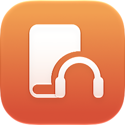
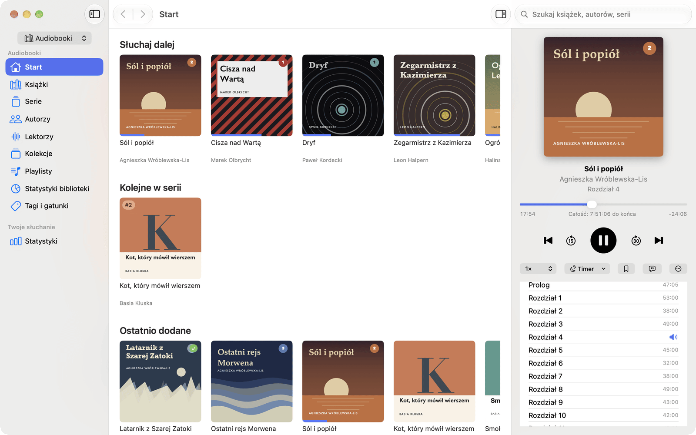
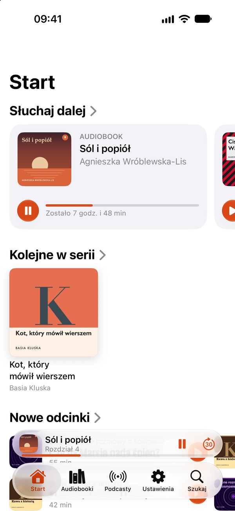
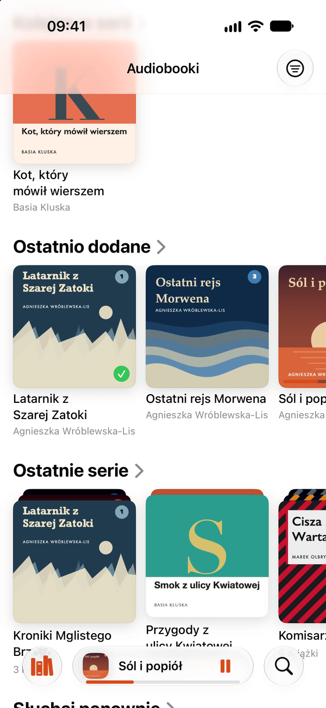
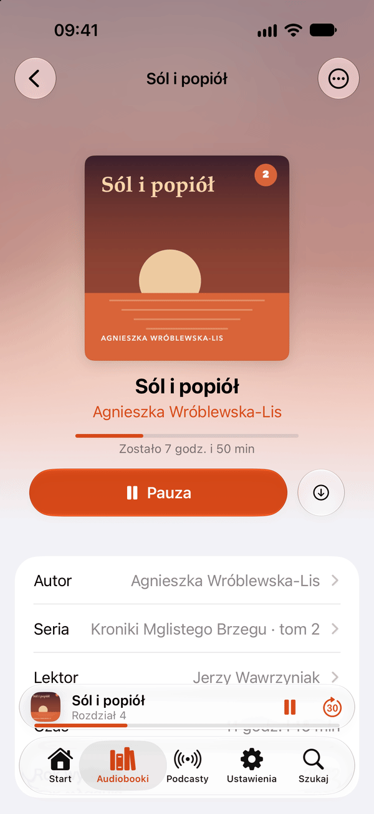
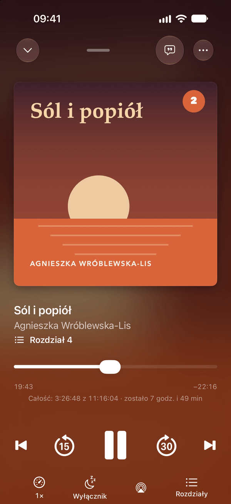

<div align="center">

<picture>
  <source media="(prefers-color-scheme: dark)" srcset=".github/assets/icon-dark.png">
  
</picture>

# Rapsod

Your own audiobook and podcast server on the Mac, with native apps to listen on Mac and iPhone.<br>
Built on [audiobookshelf](https://github.com/advplyr/audiobookshelf), without Docker, a terminal or a web browser.


[](https://github.com/lakafior/rapsod/releases/latest)
[](https://rapsod.smigi.net)

<sub>The Mac app is signed and notarized by Apple and updates itself. Apple silicon only. The interface is in Polish for now; English is on the way. The iPhone app is in development and can be built from source.</sub>

</div>

---

## What it is

Rapsod runs an audiobookshelf server from your menu bar: pick a folder with audiobooks, and your Mac becomes the server for every phone, tablet and browser at home — or anywhere, if you want. Node.js, FFmpeg and the server itself are bundled and kept up to date with the app.

Unlike a plain server wrapper, Rapsod is also a full native client. You listen, read and manage your library in Mac windows instead of a web page, and its own iPhone app pairs with the Mac by scanning a QR code.

## Highlights

<p align="center">

<picture>
  <source media="(prefers-color-scheme: dark)" srcset=".github/assets/screenshots/mac-home-dark.png">
  
</picture>

</p>

<table align="center">
<tr>
<td align="center" valign="top">

<picture>
  <source media="(prefers-color-scheme: dark)" srcset=".github/assets/screenshots/iphone-home-dark.png">
  
</picture>

<sub>Home</sub>

</td>
<td align="center" valign="top">

<picture>
  <source media="(prefers-color-scheme: dark)" srcset=".github/assets/screenshots/iphone-audiobooks-dark.png">
  
</picture>

<sub>All your libraries in one place</sub>

</td>
<td align="center" valign="top">

<picture>
  <source media="(prefers-color-scheme: dark)" srcset=".github/assets/screenshots/iphone-book-dark.png">
  
</picture>

<sub>Book pages</sub>

</td>
<td align="center" valign="top">

<picture>
  <source media="(prefers-color-scheme: dark)" srcset=".github/assets/screenshots/iphone-player-dark.png">
  
</picture>

<sub>The player</sub>

</td>
</tr>
</table>

<p align="center"><sub>Screenshots use a made-up demo library.</sub></p>

- **A server without the setup** — audiobookshelf with Node.js and FFmpeg inside the app, a library folder picked in a native window, start at login, and a supervisor that restarts the server and cleans up after it
- **A native library** — shelves, a cover grid or a Finder-style list with sortable columns, series, authors, narrators, collections, playlists and listening stats, updated live when a phone or a scan changes something
- **Listening on the Mac** — chapters, speed, sleep timer, bookmarks, Now Playing and media keys, plus a menu bar panel with the current book, Continue Listening and what the server is doing
- **Reading too** — EPUB, PDF, comics, MOBI and AZW3, with reading position shared with your phone
- **Text that follows the narrator** — when a book comes with its EPUB, speech recognition on the Mac maps every sentence to the recording; follow along in the player, tap a sentence to jump, or switch between reading and listening at the same spot
- **Podcasts** — search Apple Podcasts, fyyd and Podcast Index at once, scheduled downloads, and sponsor and self-promotion segments marked and skipped, from chapters and feed data or, optionally, from a transcript checked by any OpenAI-compatible model
- **The whole server, managed natively** — libraries and scans, metadata matching (including Polish sources: LubimyCzytać, Audioteka, Storytel and Audible), editing, covers, chapters, merging to M4B, uploads by drag and drop, users, backups, API keys, single sign-on and notifications
- **An iPhone app of its own** — paired by QR code, all libraries merged into one, offline downloads, the synced text and an EPUB and PDF reader; any other audiobookshelf app works too
- **At home or away** — sharing on the home network with Bonjour, and from anywhere through your own address or a Cloudflare Tunnel the app runs for you
- **Part of the system** — notifications, Shortcuts, Spotlight, drop a folder on the menu bar icon to add it, and updates straight from GitHub, checked for Apple's notarization and a checksum before they install
- **Native on Mac and iPhone** — SwiftUI and Liquid Glass throughout, Swift 6 with strict concurrency, and no third-party Swift packages

What's next is in the [roadmap](ROADMAP.md) (in Polish).

## Building

Requires **Xcode 27** on an Apple silicon Mac running macOS 27. Homebrew and a system Node.js aren't needed.

```bash
git clone --recursive https://github.com/lakafior/rapsod.git
cd rapsod
scripts/build-server.sh
scripts/build-ffmpeg.sh
open Rapsod/Rapsod.xcodeproj
```

Pick your own development team in Signing & Capabilities and run the **Rapsod** scheme. The iPhone app is a separate project, `iOS/RapsodiOS.xcodeproj`. Building a signed, notarized DMG is one script: see [docs/release.md](docs/release.md).

Technical documentation — how the app supervises the server, remote access, the iOS client, sponsor segments and releasing — lives in [docs/](docs/README.md) (in Polish).

## Credits

- [audiobookshelf](https://github.com/advplyr/audiobookshelf) by advplyr, the server at the heart of Rapsod, bundled unmodified
- [aio-abs-providers](https://github.com/lakafior/aio-abs-providers), the bundled metadata sources
- [AudioBooth](https://github.com/AudioBooth/AudioBooth), a reference for the audiobookshelf API
- [epub.js](https://github.com/futurepress/epub.js), [Node.js](https://nodejs.org) and [FFmpeg](https://ffmpeg.org), bundled in the app

## License

The Mac app is licensed under [GPL-3.0-or-later](LICENSE). The iPhone app and the shared `AudiobookshelfKit` package are licensed under [MPL-2.0](iOS/LICENSE). Bundled components keep their own licenses; see [docs/licensing.md](docs/licensing.md).
