# Ustawienia Maca: propozycja nowego układu

Stan na 2026-11-23, gałąź `claude/rozpoznanie-uklad-ustawien-ef9541`. Dokument jest projektem do decyzji. Kod aplikacji nie był zmieniany.

**Stan wdrożenia (2026-11-23):** etapy **1** i **2** (2a, 2b, 2c bez resetu hasła roota, 2d na Macu) są wykonane na gałęzi `claude/ustawienia-etap-1-2-uzytkownicy-631ae4`; szczegóły, odstępstwa i zrzuty w [części 10](#10-wdrożenie-etapów-1-i-2). Etapy 3–6 czekają.

**Decyzje użytkownika (2026-11-23):** wariant B; telefony dla każdego domownika; pełna kontrola nad kontem root (zmiana i reset hasła); skrót „Podłącz telefon…” na pasku menu tylko jako opcja; wygląd jak w makietach, z własnymi awatarami. Szczegóły i wpływ na plan: [część 9](#9-decyzje-z-2026-11-23-i-ich-skutki).

## Rekomendacja w skrócie

Rekomenduję **wariant B, „obiekty zamiast kategorii”**. Ma 6 stron zamiast 12:

1. Ogólne
2. Użytkownicy
3. Biblioteki
4. Dostęp zdalny
5. Powiadomienia
6. Kopie zapasowe

Osoba, biblioteka i dziennik serwera mają własne podstrony. Każda podstrona zbiera wszystkie akcje swojego obiektu.

- **„Użytkownicy”** to siatka okrągłych profili. Zastępuje trzy obecne miejsca: „Konta”, „Użytkownicy” i połowę „Udostępniania”.
- **Profil konta Maca** zbiera wszystko w jednym miejscu: telefony (parowanie, lista, odłączanie, „Kod z adresami”), hasło (pokaż, kopiuj, zmień), rolę i dostęp, statystyki oraz usuwanie konta.
- **Konto root** jest osobnym, wyszarzonym kaflem poniżej siatki. Nie da się na nim niczego zepsuć.
- **Rzadkie ustawienia** schodzą pod zwijane „Zaawansowane” na dole stron, które się do nich odnoszą. Dotyczy to skanera, okładek, sortowania, pamięci podręcznej, SSO, kluczy API, kanałów RSS i poziomu logu.
- **Nic nie znika.** Każda ze 124 pozycji spisu ma w tabeli przejścia nowe miejsce dla obu wariantów.

Ostrożniejszy **wariant A** ma 10 stron. Scala tylko oczywiste duplikaty: Konta, Użytkowników i telefon w jeden profil, a log trafia do Ogólnych. Resztę kategorii zostawia.

Przewaga wariantu B **nie** polega na mniejszej liczbie kliknięć: w typowych zadaniach jest ich tyle samo albo o jedno więcej, bo dochodzi poziom „osoba”. Opcjonalny skrót w menu na pasku skraca parowanie. Liczy się to, że każda rzecz ma jedno miejsce: 6 stron zamiast 15 widoków, bez kart segmentowych i bez trzech różnych „dostępów”. Liczby są w części 4.

| | Teraz | Wariant A | Wariant B |
|---|---|---|---|
| Strony na pasku bocznym | 12 | 10 | **6** |
| Widoki do przejrzenia (strony + karty segmentowe) | 15 | 12 | **6** (+ 4 rodzaje podstron) |
| Sekcje na stronach głównych (bez arkuszy) | ok. 30 | ok. 27 | **ok. 22** |
| Sekcje razem z podstronami obiektów | ok. 30 (podstron nie ma) | ok. 37 | ok. 39 |
| Miejsca, gdzie jest konto słuchacza | 4 strony | 1 | **1** |
| Miejsca z kluczami telefonów | 2 (pod dwiema nazwami) | 2 | **1** (+ filtr w „Kluczach API”) |
| Miejsca ze źródłami metadanych | 3 strony | 2 | **1** strona (+ ustawienie w bibliotece) |

---

## 1. Stan obecny

### 1.1 Jak liczę

- **Strona:** pozycja na pasku bocznym okna „Ustawienia aplikacji”.
- **Widok:** strona albo karta segmentowa na stronie.
- **Sekcja:** grupa (`Section`) widoczna na stronie przy domyślnym stanie (np. sekcje OpenID tylko po włączeniu), bez arkuszy. Policzona ze zrzutów, osobno dla stron głównych i podstron.
- **Arkusz:** `sheet`.
- **Kliknięcia:** liczone od kliknięcia ikony na pasku menu, czyli ikona = 1. Wpisywanie tekstu nie jest kliknięciem, wybór folderu w panelu „Otwórz” to 1. Przyjmuję, że okno ustawień otwiera się na innej stronie niż potrzebna, a warunki wstępne (np. włączenie sieci lokalnej przed parowaniem) wliczam.
- **Kontrolki:** policzone w kodzie jako deklaracje `Toggle`, `Picker`, `Button`, `TextField`, `SecureField`, `Stepper`, `DatePicker`, `Menu` i `DisclosureGroup` w plikach ustawień. Jest ich **ok. 265**, w tym przyciski w arkuszach i potwierdzeniach. Najwięcej mają „Powiadomienia i e-mail” (44), „Dostęp” (39), arkusz biblioteki (31) i „Użytkownicy” (23).

**Obecnie:**

- **12 stron.** Grupa „Aplikacja”: Ogólne, Udostępnianie, Źródła metadanych, Log serwera. Grupa „Serwer audiobookshelf”: Biblioteki, Konta, Użytkownicy, Ustawienia serwera, Dostęp, Aktywność, Powiadomienia i e-mail, Kopie zapasowe.
- **3 strony z kartami segmentowymi:** Dostęp, Aktywność, Powiadomienia. Razem daje to **15 widoków**.
- **Ok. 30 sekcji** na stronach (+3 sekcje OpenID po jego włączeniu).
- **11 arkuszy:**
  1. sparuj telefon
  2. kod z adresami
  3. edycja konta
  4. statystyki konta
  5. ustawienia biblioteki
  6. nowy klucz API
  7. sekret klucza
  8. dodaj dostawcę metadanych
  9. powiadomienie
  10. czytnik
  11. szczegóły sesji
- **Ok. 14 okien potwierdzeń.**

### 1.2 Zrzuty stanu obecnego

Zrzuty pochodzą z testowej kopii (Debug z tej gałęzi, port 13431, pusty folder danych w scratchpadzie, konto słuchacza utworzone na potrzeby zrzutu). Widać na nich lokalną nazwę logowania Maca (konto słuchacza dostało domyślną nazwę) i ścieżki tymczasowe, co warto mieć na uwadze, zanim gałąź trafi gdziekolwiek dalej. Przełącznik „Uruchamiaj przy logowaniu” pokazuje stan prawdziwej aplikacji, bo element logowania jest wspólny. Nie był przełączany. Są w [`ustawienia-nowy-uklad/obecne/`](ustawienia-nowy-uklad/obecne/).

| | | |
|---|---|---|
| 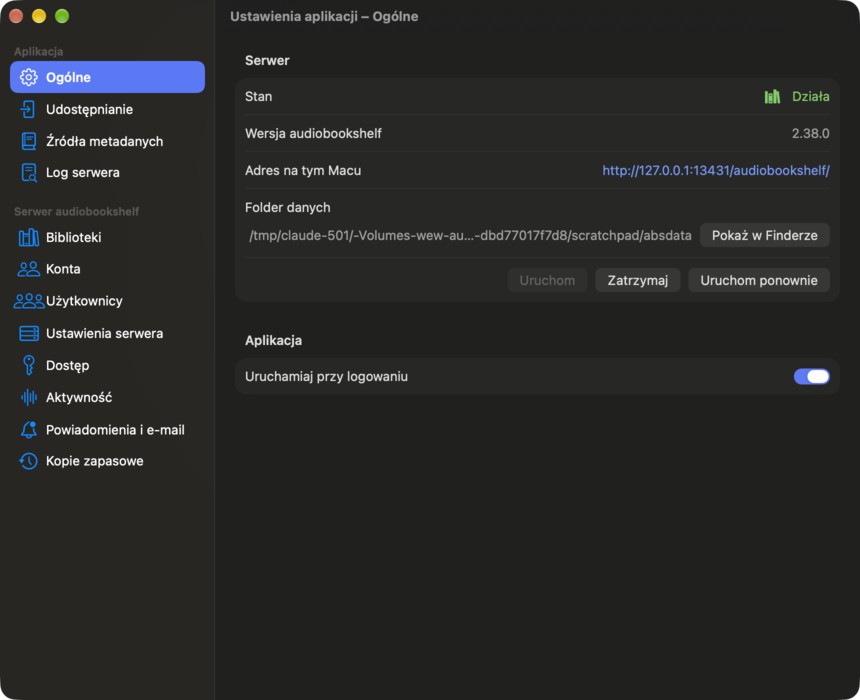 Ogólne | 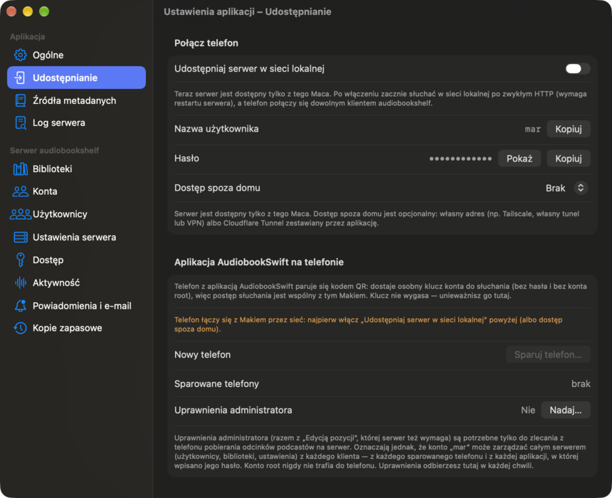 Udostępnianie | 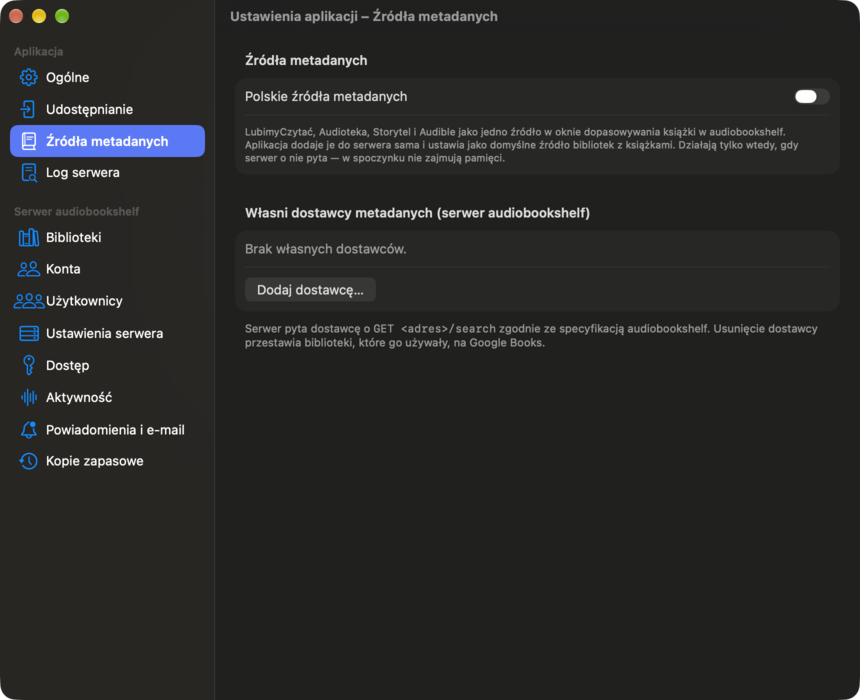 Źródła metadanych |
| 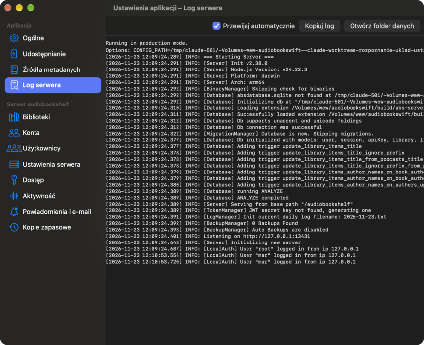 Log serwera | 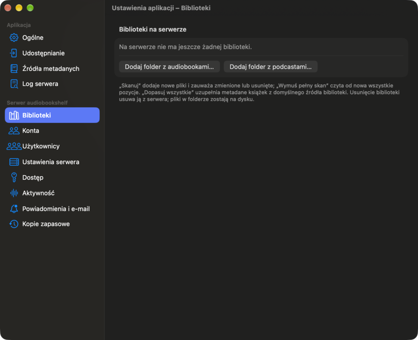 Biblioteki | 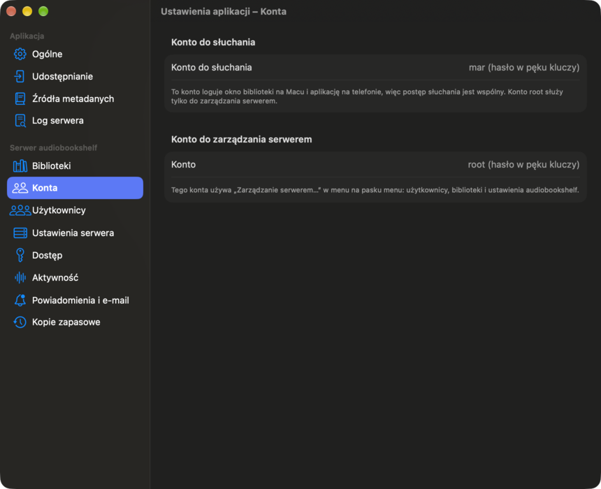 Konta |
| 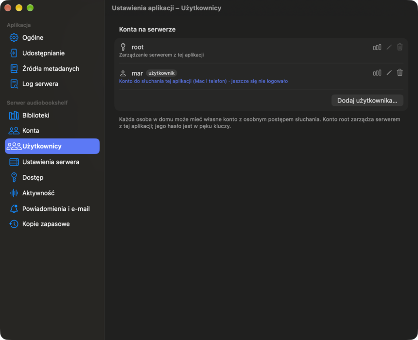 Użytkownicy | 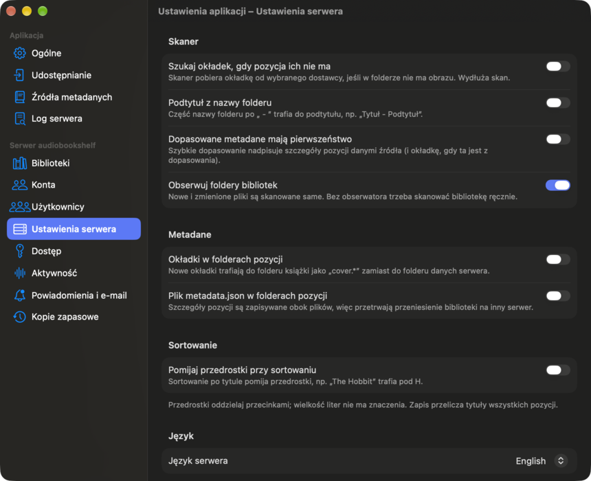 Ustawienia serwera | 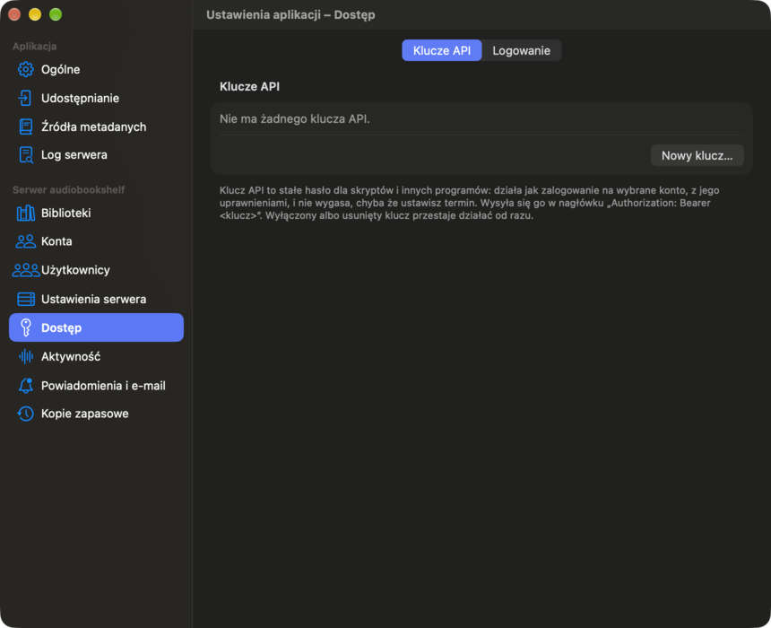 Dostęp › Klucze API |
| 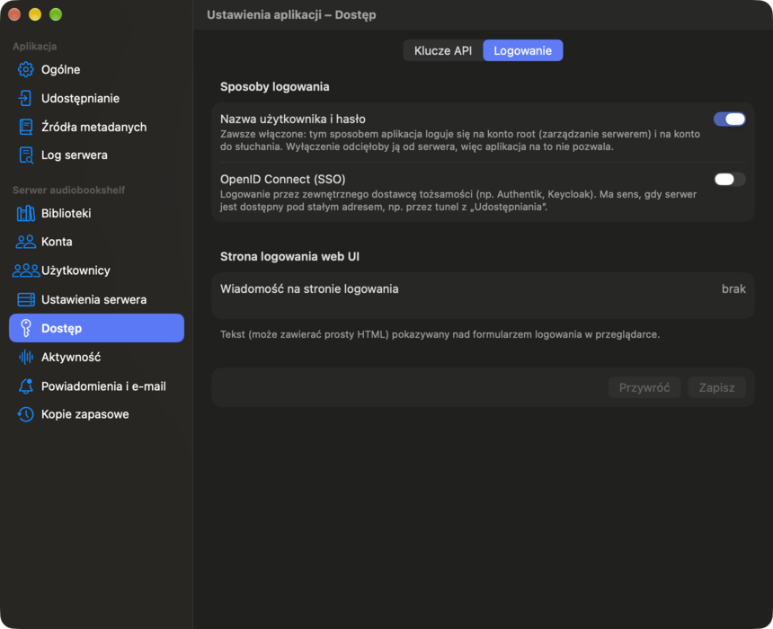 Dostęp › Logowanie | 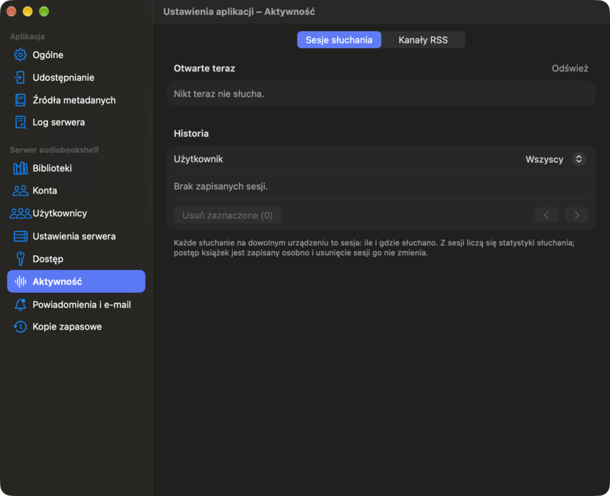 Aktywność › Sesje | 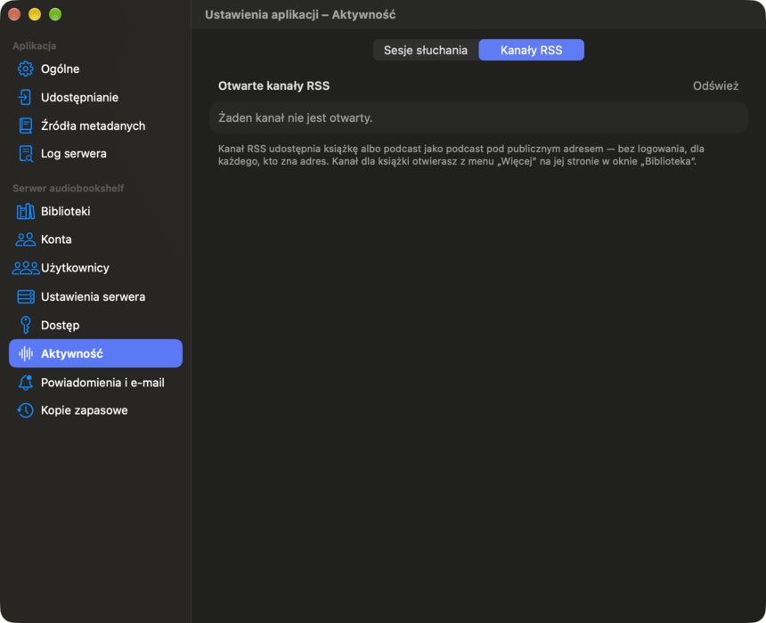 Aktywność › Kanały RSS |
| 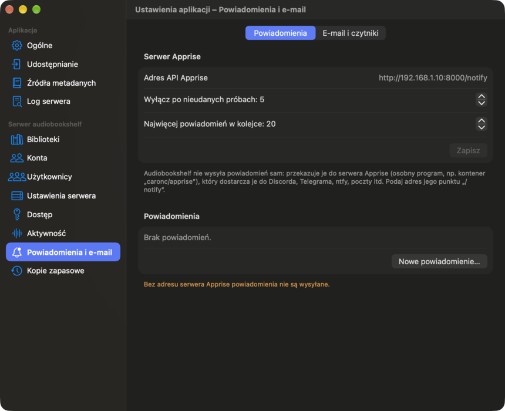 Powiadomienia | 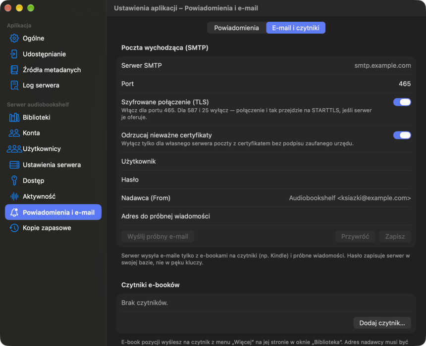 E-mail i czytniki | 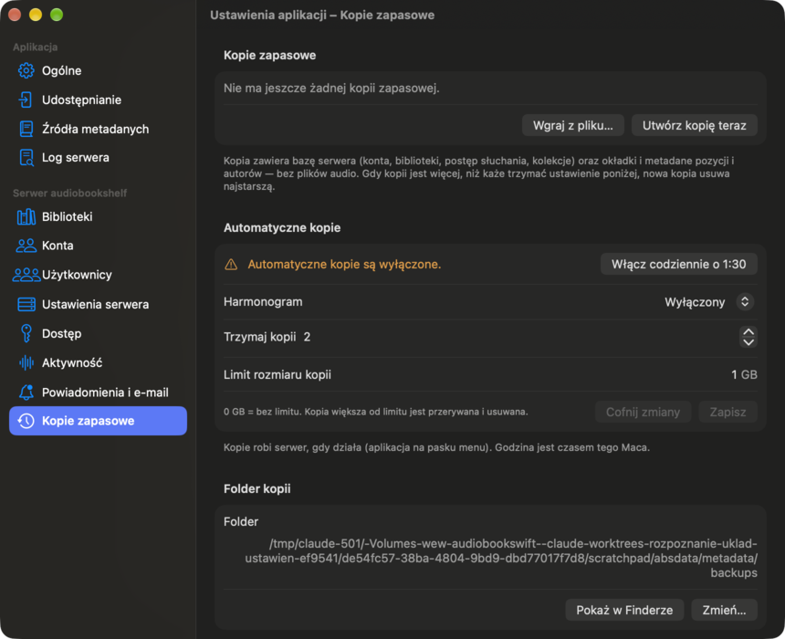 Kopie zapasowe |

Zrzutów arkusza ustawień biblioteki i arkusza parowania nie ma. Wymagają one biblioteki z plikami albo włączonego udostępniania w sieci, a tego nie chciałem robić na Macu z działającą prawdziwą kopią. Ich zawartość opisuje spis niżej, zrobiony na podstawie kodu.

### 1.3 Spis pozycji

Legenda:

- **Dotyczy:** srw = serwer, bib = biblioteka, uż = użytkownik, apl = aplikacja na Macu, urz = urządzenie (telefon).
- **Częstość:** C = codziennie albo często, K = przy konfiguracji, R = prawie nigdy.
- **Zależności:** S = działający serwer, R = zalogowane konto root, L = istnieje konto słuchacza, rst = zmiana wymaga restartu serwera.

Pliki podaję względem `AudiobookSwift/AudiobookSwift/`.

#### Menu na pasku menu i menu aplikacji (`UI/ServerMenu.swift`, `UI/AppCommands.swift`)

| ID | Pozycja | Dotyczy | Częst. | Zależn. |
|---|---|---|---|---|
| M1 | Tytuł stanu serwera („Serwer działa”, „Błąd serwera — szczegóły w ustawieniach”) | srw | C | – |
| M2 | Sterowanie odtwarzaczem (`MenuPlayerControls`) | apl | C | – |
| M3 | Otwórz bibliotekę ⌘O (⌥: Web UI audiobookshelf…) | apl | C | S |
| M4 | Ustawienia aplikacji… ⌘, (⌥: Zarządzanie serwerem (web UI)…) | apl | K | – / R |
| M5 | Uruchom serwer / Zatrzymaj serwer / Uruchom ponownie | srw | R | – |
| M6 | Uruchamiaj przy logowaniu (przełącznik) + „Wymaga zgody — otwórz Ustawienia systemowe…” | apl | K | – |
| M7 | O programie AudiobookSwift (okno: wersje, „Pokaż teksty licencji”, kod źródłowy, audiobookshelf.org) | apl | R | – |
| M8 | Zakończ (pasek menu); w menu aplikacji „Zamknij okna (serwer działa dalej)” ⌘Q i „Zakończ AudiobookSwift i wyłącz serwer” | apl | R | – |

#### Ogólne (`UI/Settings/GeneralSettingsPage.swift`)

| ID | Pozycja | Dotyczy | Częst. | Zależn. |
|---|---|---|---|---|
| G1 | Stan serwera + czytelny błąd startu z 8 liniami logu | srw | C | – |
| G2 | Wersja audiobookshelf | srw | R | – |
| G3 | Adres na tym Macu (link) | srw | R | S |
| G4 | Folder danych + „Pokaż w Finderze” | srw | R | – |
| G5 | Uruchom / Zatrzymaj / Uruchom ponownie | srw | R | – |
| G6 | Uruchamiaj przy logowaniu + prośba o zgodę („Otwórz Ustawienia”) + błąd | apl | K | – |

#### Udostępnianie › Połącz telefon (`UI/ConnectPhoneSection.swift`, `Tunnel/CloudflareTunnelSection.swift`)

| ID | Pozycja | Dotyczy | Częst. | Zależn. |
|---|---|---|---|---|
| U1 | Udostępniaj serwer w sieci lokalnej (przełącznik) + objaśnienie | srw | K | S, L, rst |
| U2 | Adres(y) w sieci lokalnej + Kopiuj | srw | K | S, U1 |
| U3 | Adres spoza domu + Kopiuj | srw | K | U6 |
| U4 | Nazwa użytkownika (konto słuchacza) + Kopiuj | uż | K | L |
| U5 | Hasło konta słuchacza: Pokaż/Ukryj + Kopiuj | uż | K | L |
| U6 | Dostęp spoza domu: Brak / Własny adres / Cloudflare Tunnel | srw | K | – |
| U7 | Własny adres (pole) + Zapisz + objaśnienie | srw | K | U6 |
| U8 | Brak `cloudflared`: instrukcja + „Sprawdź ponownie” | apl | R | U6 |
| U9 | Identyfikator tunelu + „Usuń token” | srw | R | U6 |
| U10 | Token tunelu / Nowy token (pole bezpieczne) + Zapisz + instrukcja z panelu Cloudflare | srw | K | U6 |
| U11 | Stan tunelu (+ szczegóły, problem konfiguracji, „Spróbuj ponownie”) | srw | K | U6, S, R |
| U12 | Log tunelu (rozwijany) + „Kopiuj log tunelu” | srw | R | U6 |
| U13 | Ostrzeżenia: krótkie hasło przy tunelu, ograniczenia planu darmowego Cloudflare | srw | K | U6 |

#### Udostępnianie › Aplikacja AudiobookSwift na telefonie (`UI/PhonePairingSection.swift`, `Sharing/PhonePairing.swift`)

| ID | Pozycja | Dotyczy | Częst. | Zależn. |
|---|---|---|---|---|
| P1 | Objaśnienie parowania + powód niedostępności (np. „najpierw włącz udostępnianie w sieci”) | urz | K | – |
| P2 | „Sparuj telefon…” → arkusz: nazwa telefonu, przełącznik „Nadać uprawnienia administratora?”, adresy w kodzie, Utwórz kod, kod zakryty/„Kliknij, aby pokazać”, „Anuluj i unieważnij klucz”, Gotowe | urz | K | S, R, L, U1 lub U6 |
| P3 | Lista sparowanych telefonów (nazwa, data, stan) | urz | K | R, L |
| P4 | „Unieważnij…” telefon (potwierdzenie) | urz | R | R |
| P5 | „Kod z adresami…” → arkusz z kodem QR bez klucza | urz | K | P3 niepusta |
| P6 | Uprawnienia administratora konta słuchacza: Tak/Nie, „Nadaj…” (potwierdzenie) / „Odbierz” + objaśnienie | uż | R | R, L |

#### Źródła metadanych (`MetadataSources/MetadataSourcesSection.swift`, `UI/Settings/CustomProvidersSection.swift`)

| ID | Pozycja | Dotyczy | Częst. | Zależn. |
|---|---|---|---|---|
| Z1 | Polskie źródła metadanych (przełącznik) | srw | K | – |
| Z2 | Stan + „W audiobookshelf” + „Spróbuj ponownie” | srw | R | Z1 |
| Z3 | „Konfiguracja…” (okno źródeł) | srw | R | Z1 |
| Z4 | „Wyszukiwarka…” (okno źródeł) | srw | R | Z1 |
| Z5 | Log źródeł + „Kopiuj log źródeł” | srw | R | Z1 |
| Z6 | Własni dostawcy: lista + Usuń (potwierdzenie) | srw | R | R |
| Z7 | „Dodaj dostawcę…” → arkusz: nazwa, adres, typ, nagłówek Authorization | srw | R | R |

#### Log serwera (`UI/Settings/LogSettingsPage.swift`)

| ID | Pozycja | Dotyczy | Częst. | Zależn. |
|---|---|---|---|---|
| L1 | Poziom logu serwera (śledzenie … błędy) | srw | R | R |
| L2 | Przewijaj automatycznie | apl | R | – |
| L3 | Kopiuj log | srw | R | – |
| L4 | Otwórz folder danych | srw | R | – |
| L5 | Podgląd logu | srw | R | – |

#### Biblioteki (`UI/Settings/SettingsPages.swift`, `UI/LibrarySection.swift`)

| ID | Pozycja | Dotyczy | Częst. | Zależn. |
|---|---|---|---|---|
| B1 | Lista bibliotek: nazwa, typ, foldery, stan skanu lub dopasowania | bib | K | S, R |
| B2 | Kolejność: Wyżej / Niżej | bib | R | R |
| B3 | „Skanuj” + menu: „Wymuś pełny skan”, „Dopasuj wszystkie…” (potwierdzenie) | bib | K | R |
| B4 | Ustawienia biblioteki (ikona suwaków) → arkusz BS1–BS17 | bib | K | R |
| B5 | Usuń bibliotekę (potwierdzenie) | bib | R | R |
| B6 | „Dodaj folder z audiobookami…” | bib | K | R |
| B7 | „Dodaj folder z podcastami…” | bib | K | R |
| B8 | Postęp tworzenia i skanu + „Otwórz bibliotekę” | bib | K | – |
| B9 | Formularz hasła roota, gdy go brak (także w oknie powitalnym); przy błędzie połączenia „Połącz ponownie” | srw | R | S |

#### Arkusz ustawień biblioteki (`UI/Settings/LibrarySettingsSheet.swift`)

| ID | Pozycja | Dotyczy | Częst. | Zależn. |
|---|---|---|---|---|
| BS1 | Nazwa | bib | R | R |
| BS2 | Ikona | bib | R | R |
| BS3 | Domyślne źródło metadanych / Źródło podcastów | bib | K | R |
| BS4 | Sklep iTunes do wyszukiwania (podcasty) | bib | R | R |
| BS5 | Foldery: lista, Pokaż w Finderze, Usuń folder (potwierdzenie), Dodaj folder… | bib | R | R |
| BS6 | Kwadratowe okładki | bib | R | R |
| BS7 | Obserwuj zmiany w folderze biblioteki | bib | R | R |
| BS8 | Tylko audiobooki (pomijaj pozycje z samym e-bookiem) | bib | R | R |
| BS9 | Ukryj serie z jedną książką | bib | R | R |
| BS10 | „Kontynuuj serię”: tylko książki dalsze niż przeczytane | bib | R | R |
| BS11 | Pomijaj przy dopasowaniu książki z ASIN | bib | R | R |
| BS12 | Pomijaj przy dopasowaniu książki z ISBN | bib | R | R |
| BS13 | Zezwalaj na skrypty w e-bookach EPUB | bib | R | R |
| BS14 | Źródła metadanych skanera: włącz, Przesuń wyżej/niżej | bib | R | R |
| BS15 | Automatyczny skan: harmonogram, dzień, godzina, wyrażenie cron | bib | R | R |
| BS16 | Oznacz jako ukończone, gdy (zostało sekund / przesłuchano %) + wartość | bib | R | R |
| BS17 | Narzędzia: Usuń pliki metadata.json / metadata.abs (potwierdzenie) | bib | R | R |

#### Konta (`UI/Settings/SettingsPages.swift`, `UI/UserAccountSection.swift`)

| ID | Pozycja | Dotyczy | Częst. | Zależn. |
|---|---|---|---|---|
| K1 | Konto do słuchania: nazwa („hasło w pęku kluczy”) albo formularz założenia (nazwa, hasło, „Utwórz konto”) | uż | K | S, R |
| K2 | Konto do zarządzania serwerem: root (informacja) | uż | R | S |
| K3 | Formularz hasła roota („Zaloguj i zapamiętaj w pęku kluczy”), gdy go brak | uż | R | S |

#### Użytkownicy (`UI/Settings/UsersSettingsPage.swift`)

| ID | Pozycja | Dotyczy | Częst. | Zależn. |
|---|---|---|---|---|
| US1 | Lista kont: nazwa, typ, nieaktywne, zablokowane, „ostatnio”, oznaczenie konta aplikacji | uż | K | R |
| US2 | Statystyki słuchania (arkusz) | uż | R | R |
| US3 | Edytuj (arkusz): nazwa, nowe hasło, typ konta, aktywne; dla konta aplikacji typ i aktywność są zablokowane | uż | K | R |
| US4 | Uprawnienia: pobieranie, edycja pozycji, usuwanie, wgrywanie, treści dla dorosłych | uż | R | R |
| US5 | Dostęp do bibliotek: wszystkie / wybrane | uż | R | R |
| US6 | Dostęp według tagów: wszystkie / wybrane dostępne / wybrane niedostępne | uż | R | R |
| US7 | Usuń konto (potwierdzenie; osobne ostrzeżenie dla konta aplikacji; root zablokowany) | uż | R | R |
| US8 | „Dodaj użytkownika…” | uż | K | R |

#### Ustawienia serwera (`UI/Settings/ServerSettingsPage.swift`)

| ID | Pozycja | Dotyczy | Częst. | Zależn. |
|---|---|---|---|---|
| S1 | Szukaj okładek, gdy pozycja ich nie ma | srw | R | R |
| S2 | Dostawca okładek | srw | R | R, S1 |
| S3 | Podtytuł z nazwy folderu | srw | R | R |
| S4 | Dopasowane metadane mają pierwszeństwo | srw | R | R |
| S5 | Obserwuj foldery bibliotek (globalnie) + „Uruchom ponownie” | srw | R | R, rst |
| S6 | Okładki w folderach pozycji | srw | R | R |
| S7 | Plik metadata.json w folderach pozycji | srw | R | R |
| S8 | Pomijaj przedrostki przy sortowaniu | srw | R | R |
| S9 | Przedrostki (pole) + Zapisz | srw | R | R, S8 |
| S10 | Język serwera | srw | R | R |
| S11 | Wyczyść okładki pozycji… (potwierdzenie) | srw | R | R |
| S12 | Wyczyść całą pamięć podręczną… (potwierdzenie) | srw | R | R |

#### Dostęp (`UI/Settings/AccessSettingsPage.swift`)

| ID | Pozycja | Dotyczy | Częst. | Zależn. |
|---|---|---|---|---|
| D1 | Karta „Klucze API”: lista (stan, szczegóły), Włącz/Wyłącz, Usuń (potwierdzenie); **tu są też klucze telefonów** | uż | R | R |
| D2 | „Nowy klucz…” → arkusz: nazwa, konto, wygasa, dni, aktywny od razu | uż | R | R |
| D3 | Arkusz z sekretem nowego klucza + Kopiuj | uż | R | R |
| D4 | Karta „Logowanie”: sposoby logowania (hasło — zablokowane włączone; OpenID) | srw | R | R |
| D5 | OpenID: wystawca + „Uzupełnij adresy”, adresy autoryzacji, tokenu, userinfo, JWKS i wylogowania, identyfikator i sekret klienta, algorytm podpisu | srw | R | R, D4 |
| D6 | OpenID: podfolder przekierowań, przekierowania aplikacji mobilnych, tekst przycisku, dopasowanie kont, auto-przekierowanie, auto-zakładanie kont, claim grupy, claim uprawnień | srw | R | R, D4 |
| D7 | Wiadomość na stronie logowania web UI | srw | R | R |
| D8 | Przywróć / Zapisz (logowanie) | srw | R | R |

#### Aktywność (`UI/Settings/ActivitySettingsPage.swift`)

| ID | Pozycja | Dotyczy | Częst. | Zależn. |
|---|---|---|---|---|
| AK1 | Karta „Sesje słuchania” › Otwarte teraz: lista, Zamknij, Pokaż szczegóły, Odśwież | uż | R | R |
| AK2 | Historia: filtr użytkownika, zaznaczanie, „Usuń zaznaczone”, stronicowanie, szczegóły (arkusz z „Usuń…”) | uż | R | R |
| AK3 | Karta „Kanały RSS”: lista otwartych kanałów, Kopiuj adres, Zamknij… (potwierdzenie), Odśwież | bib | R | R |

#### Powiadomienia i e-mail (`UI/Settings/NotificationsSettingsPage.swift`)

| ID | Pozycja | Dotyczy | Częst. | Zależn. |
|---|---|---|---|---|
| N1 | Karta „Powiadomienia” › Serwer Apprise: adres API, wyłącz po nieudanych próbach, limit kolejki, Zapisz | srw | R | R |
| N2 | Lista powiadomień: Włącz/Wyłącz, menu (Edytuj…, Wyślij próbę, Usuń…) | srw | R | R, N1 |
| N3 | „Nowe powiadomienie…” → arkusz: zdarzenie, biblioteka, adresy Apprise, tytuł, treść, rodzaj, włączone | srw | R | R |
| N4 | Karta „E-mail i czytniki” › SMTP: serwer, port, TLS, odrzucaj niezaufane certyfikaty, użytkownik, hasło, nadawca, adres próbny, „Wyślij próbny e-mail”, Przywróć/Zapisz | srw | R | R |
| N5 | Czytniki e-booków: lista, Edytuj…, Usuń (potwierdzenie), „Dodaj czytnik…” → arkusz: nazwa, e-mail, dostępny dla (użytkownicy) | srw | R | R, N4 |

#### Kopie zapasowe (`UI/Settings/BackupsSettingsPage.swift`)

| ID | Pozycja | Dotyczy | Częst. | Zależn. |
|---|---|---|---|---|
| KZ1 | Lista kopii: Przywróć… (potwierdzenie), Pokaż w Finderze, Usuń (potwierdzenie) | srw | R | R |
| KZ2 | Wgraj z pliku… | srw | R | R |
| KZ3 | Utwórz kopię teraz | srw | R | R |
| KZ4 | Automatyczne kopie: „Włącz codziennie o 1:30”, harmonogram, dzień, godzina, cron | srw | K | R |
| KZ5 | Trzymaj kopii (liczba), limit rozmiaru (GB), Cofnij zmiany / Zapisz | srw | R | R |
| KZ6 | Folder kopii: ścieżka, Pokaż w Finderze, Zmień… | srw | R | R |

#### Poza oknem ustawień (zostaje tam, gdzie jest; tylko do kontroli kompletności)

| ID | Pozycja | Miejsce |
|---|---|---|
| X1 | Okno powitalne (pierwsza biblioteka; ten sam `LibrarySection`) | `UI/WelcomeWindow.swift` |
| X2 | Okno „Źródła metadanych” (konfiguracja, wyszukiwarka) | `MetadataSources/` |
| X3 | Edytor pozycji, narzędzia pozycji, działania wsadowe, wgrywanie, dodawanie podcastu, odcinki | `Listening/Manage/` (okno „Biblioteka”) |
| X4 | Zarządzanie gatunkami, tagami i narratorami | `Listening/Browse/LibraryManagement.swift` |
| X5 | Preferencje kontekstowe zapamiętane w `@AppStorage`: ustawienia czytnika, czcionka i skala tekstu książki, panel tekstu, „kopia przed osadzeniem metadanych” (`tools.embedBackup`), kraj wyszukiwania podcastów, region dopasowania autora, lista w zarządzaniu metadanymi | okna czytnika, tekstu, biblioteki |
| X6 | „Ustawienia i log…” w oknie biblioteki i web UI przy błędzie serwera → otwiera Ogólne | `LibraryWindow.swift`, `WebUIWindow.swift` |
| X7 | „Otwórz Ustawienia → Powiadomienia i e-mail” przy wysyłce na czytnik | `ItemActions.swift`, `ShareSheets.swift` |
| X8 | Formularz „Utwórz konto użytkownika” (`UserAccountSetup`) w oknach Biblioteka i web UI, gdy nie ma konta słuchacza | `UserAccountSection.swift`, `LibraryWindow.swift`, `WebUIWindow.swift` |

Zasada dla X3–X5 (zgodna z HIG): ustawienia związane z konkretnym zadaniem zostają przy nim, nie w oknie ustawień. Pozycje X1–X8 nie wymagają przeniesienia. X6 i X7 to wejścia do ustawień i zmieniają tylko cel.

**Razem: 124 pozycje**, z czego 116 w oknie ustawień i menu oraz 8 poza nim. Etykiety wszystkich kontrolek z plików ustawień (`grep` po `Button`, `Toggle`, `Picker`, polach i `LabeledContent`) zostały zestawione z tym spisem; każda należy do którejś pozycji. Jedyna kontrolka bez nowego miejsca to przełącznik kart „Widok” na trzech stronach, który znika razem z kartami.

### 1.4 Duplikaty i niespójności

**Ta sama rzecz w kilku miejscach**

1. **Konto słuchacza jest w czterech miejscach:**
   - „Konta”: nazwa i założenie konta,
   - „Udostępnianie”: nazwa i hasło do skopiowania,
   - „Udostępnianie” › telefon: uprawnienia administratora,
   - „Użytkownicy”: edycja.
2. **Uprawnienia administratora słuchacza:** w „Udostępnianiu” i w arkuszu parowania da się je nadać. W edytorze „Użytkownicy” typ tego konta jest zablokowany. Ta sama właściwość raz się zmienia, a raz nie.
3. **Klucze telefonów są w dwóch miejscach pod różnymi nazwami.** W „Udostępnianiu” to „Sparowane telefony” z akcją „Unieważnij”. W „Dostęp › Klucze API” to zwykłe klucze o nazwie z przedrostkiem, z akcjami „Wyłącz” i „Usuń” i bez ostrzeżenia, że to telefon.
4. **Formularz hasła roota:** „Konta” i „Biblioteki” (oraz okno powitalne). Inne strony odsyłają tekstem: „podaj jego hasło na podstronie »Konta«”.
5. **Folder danych:** „Ogólne” („Pokaż w Finderze”) i „Log serwera” („Otwórz folder danych”).
6. **Start, stop i restart serwera:** menu na pasku i „Ogólne”. Start przy logowaniu: menu i „Ogólne”. To akceptowalne, bo menu to skróty, ale w ustawieniach wystarczy jedno miejsce.
7. **Źródła metadanych na trzech stronach:**
   - „Źródła metadanych”: polskie źródła i własni dostawcy,
   - arkusz biblioteki: domyślne źródło i źródła skanera,
   - „Ustawienia serwera”: dostawca okładek i pierwszeństwo dopasowanych.
8. **Obserwator folderów** ma dwa przełączniki o prawie tej samej nazwie: globalny „Obserwuj foldery bibliotek” (S5) i „Obserwuj zmiany w folderze biblioteki” w każdej bibliotece (BS7). Nie widać, który wygrywa.
9. **Harmonogram cron** ma dwie osobne kopie tego samego komponentu: automatyczny skan (BS15) i automatyczne kopie (KZ4).

**Niespójne nazwy**

10. „Konta” i „Użytkownicy” to dwie strony, a w treści pojawia się jeszcze „Konta na serwerze”.
11. Trzy różne „dostępy”: „Dostęp” (klucze i SSO), „Dostęp spoza domu” (w „Udostępnianiu”) i „Dostęp do bibliotek” (w edycji konta).
12. Telefon jest „unieważniany”, a klucz API „usuwany”.
13. Ten sam rejestr nazywa się raz „Log serwera”, a raz „Ustawienia i log…”.
14. „Ogólne” leżą w grupie „Aplikacja”, ale opisują głównie serwer. „Log serwera” też leży w grupie „Aplikacja”.
15. „Udostępnianie” nie udostępnia pozycji. Jest za to arkusz „Udostępnij” w oknie biblioteki (publiczne linki i RSS).

**Niespójne wzorce**

16. **Zapisywanie zmian:**
    - natychmiast: „Ustawienia serwera”, przełączniki w arkuszu biblioteki dopiero po „Zapisz”,
    - przyciskiem „Zapisz” w wierszu: przedrostki, własny adres, token,
    - parą „Przywróć/Zapisz” sekcji: logowanie, SMTP, kopie,
    - „Anuluj/Zapisz” w arkuszu.
17. **Akcje w wierszach list:**
    - same ikony: Użytkownicy i Biblioteki (ołówek, kosz, suwaki, wykres),
    - przyciski tekstowe: Klucze API („Wyłącz”), Telefony („Unieważnij…”), RSS („Zamknij…”),
    - menu „…”: Powiadomienia.
18. **Karty segmentowe na trzech stronach.** Druga karta łatwo umyka, a karty nie są widoczne na pasku bocznym.
19. **„Aktywność”** (sesje, kanały RSS) to przegląd danych, a nie ustawienia.
20. **Okno nie zapamiętuje strony między uruchomieniami.** Zapamiętuje ją tylko w trakcie działania aplikacji (`SettingsNavigation` w `AppDelegate`). HIG zaleca przywracać ostatnio oglądaną stronę.

---

## 2. Wzorce

Źródła:

- **[HIG: Settings](https://developer.apple.com/design/human-interface-guidelines/settings).** Ostatnia zmiana 10 czerwca 2024.
- **[HIG: Sidebars](https://developer.apple.com/design/human-interface-guidelines/sidebars).** Zmiana z 8 czerwca 2026 dotyczy kolorów ikon i stylu „adaptable sidebar”, który HIG opisuje tylko dla iOS i iPadOS.
- **Doniesienia o macOS 27.** Według prasy ([MacRumors](https://macrumors.com/2026/06/10/apple-lists-250-changes-ios-27-and-more/), [TechRadar](https://techradar.com/computing/mac-os/macos-27-golden-gate-announced-at-wwdc-2026-heres-everything-you-need-to-know)) macOS 27 to raczej poprawki niż nowy wygląd. Ustawienia systemowe dostały suwak przezroczystości Liquid Glass, a w Ustawieniach systemowych znikło stopniowe rozmycie krawędzi przy przewijaniu. **Nie znalazłem w dokumentacji Apple nowych zaleceń dla układu okna ustawień w macOS 27.** To, co tu piszę o macOS 27, opiera się na prasie, a nie na HIG.

**Wzorcowe okna ustawień i co z nich biorę.** Opisy są z pamięci; w tej sesji nie robiłem zrzutów tych aplikacji ani nie sprawdzałem ich wersji na macOS 27.

- **Ustawienia systemowe.** Obiekt jako strona: „Użytkownicy i grupy” → osoba → wszystkie jej akcje. „Sieć” → usługa → szczegóły. Zaawansowane są w osobnym arkuszu albo na dole strony.
- **Ustawienia systemowe › Apple ID i Rodzina.** Duże okrągłe awatary osób i strona osoby. Najbliższe „profilom z Netflixa”, a przy tym natywne dla Maca.
- **Safari / Mail (Ustawienia).** Mała liczba kart i krótkie nazwy. Rzadkie opcje są na karcie „Zaawansowane”, a nie rozsiane po stronach.
- **Tailscale (aplikacja na Maca)** i **Plex Media Server.** Stan łączności pokazany jako odpowiedź na pytanie „skąd mnie widać”, a nie jako lista przełączników. Ostrzeżenie o urządzeniach, które trzeba zaktualizować.
- **1Password / Bitwarden.** Hasło w wierszu: kropki, „Pokaż”, „Kopiuj” i osobno „Zmień…”.

**Zasady, które stosuję w propozycji**

1. **Obiekt = strona.** Użytkownik, biblioteka i dziennik mają własne podstrony ze wszystkimi swoimi akcjami. Kategorie na pasku bocznym to tylko zbiory obiektów i ustawień globalnych.
2. **Jedno miejsce na każdą rzecz.** Odwołanie z innego miejsca to przycisk prowadzący do tego miejsca albo otwierający ten sam arkusz, a nie kopia kontrolek.
3. **Stopniowe ujawnianie.** Na górze strony jest stan i najczęstsza akcja, niżej ustawienia konfiguracyjne. Na samym dole jest zwinięte „Zaawansowane” z jednym zdaniem streszczenia, co jest w środku.
4. **Brak kart segmentowych.** Długa strona z sekcjami albo podstrona zamiast drugiej karty.
5. **Jeden wzorzec zapisu.** Przełączniki i wybory zapisują się od razu, tak jak w Ustawieniach systemowych. Pola tekstowe i formularze wielopolowe (SMTP, OpenID, token) idą przez arkusz z „Anuluj/Zapisz”.
6. **Jeden wzorzec akcji w wierszu.** Klik w wiersz otwiera obiekt (chevron). Akcje mają nazwy tekstowe: przyciski „Skanuj”, „Odłącz…”, „Kopiuj”. Akcje niszczące są na dole strony obiektu, na czerwono, z potwierdzeniem.
7. **Bezpieczne domyślne i zabezpieczenia na widoku.**
   - Root nie jest kaflem obok domowników.
   - Konto Maca ma odznakę i przy usuwaniu opis skutków.
   - Uprawnienia administratora zawsze idą z wyjaśnieniem w stopce.
8. **Ten sam słownik w całej aplikacji i w kliencie iOS:**
   - **„Podłącz telefon” / „Odłącz”** zamiast „Sparuj” / „Unieważnij klucz”,
   - **„Dostęp zdalny”** (jedyny „dostęp” jako nazwa strony),
   - **„Dziennik serwera”** zamiast „Log serwera”.
9. **Okno przywraca ostatnią stronę** po ponownym uruchomieniu (`@AppStorage`). Tytuł okna zostaje stały („Ustawienia”), a nazwa strony jest w podtytule, tak jak teraz, żeby okno było rozpoznawalne w Docku. To świadome odstępstwo od HIG, który zaleca nazwę strony w tytule.
10. **Pasek boczny zamiast paska narzędzi z kartami.** HIG zaleca pasek narzędzi, ale przy podstronach obiektów (profil, biblioteka) pasek boczny z `NavigationStack` w szczegółach jest czytelniejszy i zgodny z Ustawieniami systemowymi. Przy 6 stronach pasek narzędzi byłby wykonalny (pytanie 6).
11. **Liquid Glass bez własnych efektów.** Standardowy `NavigationSplitView` dostaje szkło paska bocznego od systemu. Ikony paska bocznego idą w kolorze akcentu, bez stałych kolorów.

---

## 3. Propozycja struktury

### 3.1 Wariant A — ostrożny (10 stron)

Scala tylko oczywiste duplikaty i zostawia resztę kategorii.

```
Ustawienia
├─ Ogólne              stan i sterowanie serwerem, start przy logowaniu,
│   └─ Dziennik serwera   (podstrona: dawny „Log serwera” + poziom logu)
├─ Użytkownicy         siatka profili (jak w B): dawne Konta + Użytkownicy + telefon z Udostępniania
│   ├─ <osoba>            telefony, hasło, rola i dostęp, statystyki, usuń
│   └─ Administrator serwera (root)
├─ Dostęp zdalny       dawne „Udostępnianie” bez telefonu: sieć lokalna, spoza domu, tunel
├─ Biblioteki          lista + arkusz biblioteki (bez zmian)
├─ Metadane            dawne „Źródła metadanych” + skaner/okładki z „Ustawień serwera”
├─ Serwer              język, sortowanie, metadane w folderach, pamięć podręczna
├─ Logowanie i klucze  dawny „Dostęp” (dwie karty → dwie sekcje)
├─ Aktywność           bez zmian
├─ Powiadomienia i e-mail   bez zmian (karty zostają)
└─ Kopie zapasowe      bez zmian
```

Zalety: mało ryzyka, każdy etap jest mały i niewiele tekstów do zmiany.
Wady: dalej 10 kategorii; „Metadane”, „Serwer” i „Logowanie i klucze” to wciąż szuflady technicznych opcji. Karty segmentowe zostają na dwóch stronach.

### 3.2 Wariant B — obiekty zamiast kategorii (6 stron) — **rekomendowany**

```
Ustawienia
├─ Ogólne
│   ├─ Serwer: stan (+ błąd z logiem), adres na tym Macu, Uruchom / Zatrzymaj / Uruchom ponownie
│   ├─ Aplikacja: Uruchamiaj przy logowaniu
│   ├─ Dziennik serwera ›         (podstrona: podgląd, przewijanie, kopiuj)
│   └─ Zaawansowane ▸ wersja audiobookshelf, folder danych, poziom logu, język serwera
│
├─ Użytkownicy                    „Kto słucha?” — siatka okrągłych profili + „Dodaj osobę”
│   ├─ <osoba> ›                   (podstrona profilu)
│   │   ├─ nagłówek: awatar, odznaki „Konto tego Maca”/rola, „słucha teraz…”
│   │   ├─ Telefony (tylko konto Maca): lista, Odłącz…, Podłącz telefon…, Kod z adresami…
│   │   ├─ Hasło: Pokaż · Kopiuj · Zmień…; „Dane logowania do innych aplikacji…”
│   │   ├─ Rola i dostęp: Użytkownik/Administrator, podsumowanie, „Zarządzaj rolą i dostępem…”
│   │   ├─ Słuchanie: statystyki, „Statystyki i sesje…”
│   │   ├─ Zaawansowane ▸ nazwa konta, dostęp według tagów, aktywne, klucze API tego konta
│   │   └─ Usuń konto… (czerwony, z opisem skutków)
│   ├─ Administrator serwera (root) ›   kafel pod siatką, wyszarzony; strona tylko do odczytu
│   └─ „Historia słuchania wszystkich…” › (dawna Aktywność › Historia + otwarte sesje)
│
├─ Biblioteki
│   ├─ Biblioteki: lista (wiersz → podstrona), Skanuj, „Dodaj audiobooki…”, „Dodaj podcasty…”
│   │   └─ <biblioteka> ›          dawny arkusz + kolejność, pełny skan, dopasuj wszystkie, usuń
│   │       └─ Zaawansowane ▸ e-booki, ASIN/ISBN, skrypty EPUB, źródła skanera, pliki metadata
│   ├─ Metadane: polskie źródła (stan, Konfiguracja…, Wyszukiwarka…), własni dostawcy
│   └─ Zaawansowane ▸ skaner i okładki (wspólne), sortowanie, zapis w folderach, pamięć podręczna
│
├─ Dostęp zdalny
│   ├─ „Skąd można słuchać”: Ten Mac / Sieć domowa / Spoza domu (stan i adres)
│   ├─ baner: „N telefonów nie zna nowego adresu → Pokaż kod z adresami…” (ten sam arkusz co w profilu)
│   ├─ Sieć domowa: przełącznik, adresy + Kopiuj
│   ├─ Spoza domu: Wyłączony / Własny adres / Cloudflare Tunnel, stan, adres, token (Zmień…)
│   └─ Zaawansowane ▸ logowanie (OpenID/SSO, wiadomość na stronie logowania),
│                     klucze API (wszystkie; klucze telefonów oznaczone i z linkiem do profilu),
│                     publiczne kanały RSS, log tunelu
│
├─ Powiadomienia                  Apprise + lista powiadomień; „E-mail na czytniki”: czytniki,
│   └─ Zaawansowane ▸ serwer poczty (SMTP…), limity Apprise
│
└─ Kopie zapasowe                 lista, Utwórz teraz, Wgraj z pliku, automatyczne kopie
    └─ Zaawansowane ▸ liczba kopii, limit rozmiaru, folder kopii, własny cron
```

**Konto Maca i root, żeby nie dało się zrobić sobie krzywdy**

- **Konto Maca** ma na kaflu odznakę z Makiem i telefonem, a na profilu podpis „Konto tego Maca”. Nie da się go dezaktywować, bo przełącznik „Aktywne” jest ukryty, tak jak dziś zablokowany. Rola jest zmienialna, ale wybór „Administrator” pyta o potwierdzenie (jak dziś „Nadaj…”) i, tak jak obecne `setListenerAdmin`, włącza też „Edycję pozycji”, której serwer wymaga do pobierania odcinków. Usuwanie jest na samym dole, z opisem skutków (zatrzyma odtwarzanie, wyloguje telefony, skasuje postęp) i potwierdzeniem, które powtarza nazwę konta.
- **Root nie jest w siatce domowników.** To wąski, szary kafel z kłódką pod siatką z opisem „Konto techniczne aplikacji. Nie trafia do telefonów, nie da się go usunąć.” Strona roota nie ma akcji telefonów, roli ani usuwania. Hasło: Pokaż · Kopiuj · Zmień…, a pod „Zaawansowane” „Zaloguj ponownie hasłem…” (dawne K3/B9) i „Zresetuj hasło…” (decyzja z części 9; pierwotnie strona była tylko do odczytu).
- **Telefony są na profilu każdej osoby** (decyzja z części 9). Dziś `PhonePairing` paruje wyłącznie konto słuchacza, więc to nowa funkcja w etapie 2b.
- **„Pokaż” i „Kopiuj” hasło są tylko tam, gdzie aplikacja zna hasło,** czyli na koncie Maca (pęk kluczy). Na innych profilach jest tylko „Zmień…”, bo serwer haseł nie zwraca.
- **Brak konta Maca:** pierwszym kaflem jest „Utwórz konto tego Maca” ze znakiem uwagi. Ten sam znak pojawia się przy „Użytkownikach” na pasku bocznym.
- **Menu kontekstowe kafla** daje skróty bez wchodzenia w profil: „Podłącz telefon…”, „Kopiuj hasło”, „Zmień hasło…”. To te same arkusze co na profilu.

**Dlaczego B**

- Każdy obszar z polecenia ma jedno, przewidywalne miejsce. Telefon jest u osoby, sieć w „Dostępie zdalnym”, źródło metadanych w „Bibliotekach”.
- Znikają trzy szuflady bez wyraźnego obiektu: „Ustawienia serwera”, „Dostęp” i „Aktywność”. Ich zawartość trafia tam, czego dotyczy.
- Trzy strony z kartami znikają. Druga karta przestaje być ukrytym miejscem.
- Etapy wdrożenia są podobnej wielkości jak w A. Różnica to dwa etapy więcej (część 5).

**Obszary z zadania → miejsce w wariancie B**

| Obszar | Gdzie |
|---|---|
| Użytkownicy, konta, telefony | Użytkownicy (siatka, profil, root) |
| Biblioteki | Biblioteki › lista i podstrona biblioteki |
| Serwer i zdalny dostęp | Ogólne (stan, start/stop, adres) i Dostęp zdalny (sieć domowa, spoza domu, SSO, klucze API) |
| Podcasty | Biblioteki: „Dodaj podcasty…”, sklep iTunes i źródło na podstronie biblioteki podcastów. Ustawienia pojedynczego podcastu (automatyczne pobieranie, harmonogram) i kolejka odcinków zostają w oknie Biblioteka (X3). Uprawnienie do pobierania z telefonu: profil konta Maca › Rola. |
| Metadane | Biblioteki › Metadane (polskie źródła, własni dostawcy); źródło domyślne i źródła skanera na podstronie biblioteki; skaner i okładki wspólne › Zaawansowane |
| Kopie zapasowe | Kopie zapasowe |
| Powiadomienia | Powiadomienia (Apprise, e-mail na czytniki, SMTP pod „Zaawansowane”) |
| Dziennik | Ogólne › Dziennik serwera; log tunelu w Dostęp zdalny › Zaawansowane; log źródeł w Biblioteki › Metadane |
| Narzędzia | Narzędzia bibliotek (skan, pełny skan, dopasuj wszystkie, pliki metadata, pamięć podręczna): Biblioteki. Narzędzia pozycji (M4B, osadzanie metadanych, wsadowe): okno Biblioteka (X3), bez zmian. |
| Wygląd i zachowanie aplikacji | Ogólne › Aplikacja (start przy logowaniu). Aplikacja nie ma dziś innych ustawień wyglądu; preferencje czytnika i tekstu książki zostają w swoich oknach (X5). Ikona w Docku pojawia się sama przy otwartym oknie i nie ma przełącznika. |

### 3.3 Makiety (wariant B)

Makiety to prawdziwe widoki SwiftUI z danymi przykładowymi, w samodzielnej aplikacji [`ustawienia-nowy-uklad/makiety/Makieta.swift`](ustawienia-nowy-uklad/makiety/Makieta.swift). Leżą poza celem AudiobookSwift: folder `AudiobookSwift/AudiobookSwift/` jest synchronizowany z celem, `docs/` nie jest. Okna są wyrenderowane i przechwycone skryptem [`render.sh`](ustawienia-nowy-uklad/makiety/render.sh) w jasnym i ciemnym wyglądzie przy szerokości obecnego okna (860 pt). Profil i „Dostęp zdalny” mają wyższe okno, żeby było widać całą stronę. Osoby i adresy są zmyślone. Pliki PNG są w [`ustawienia-nowy-uklad/makiety-png/`](ustawienia-nowy-uklad/makiety-png/).

**Użytkownicy — siatka profili**

| Jasny | Ciemny |
|---|---|
| 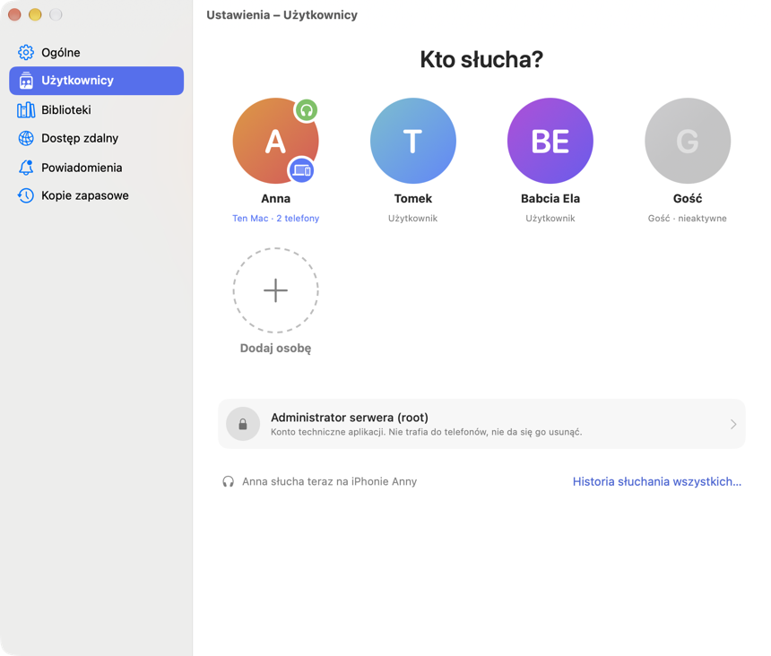 | 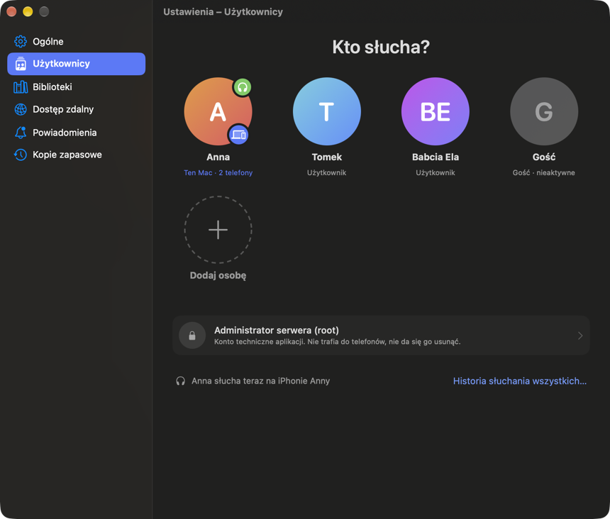 |

**Profil konta Maca: wszystkie akcje w jednym miejscu**

| Jasny | Ciemny |
|---|---|
| 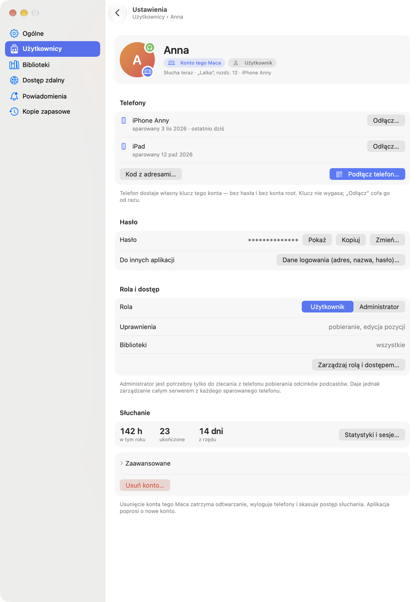 | 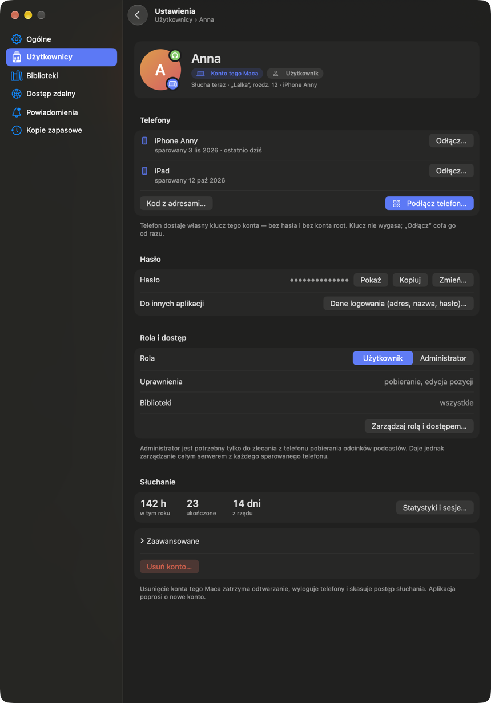 |

**Administrator serwera (root): tylko do odczytu**

| Jasny | Ciemny |
|---|---|
| 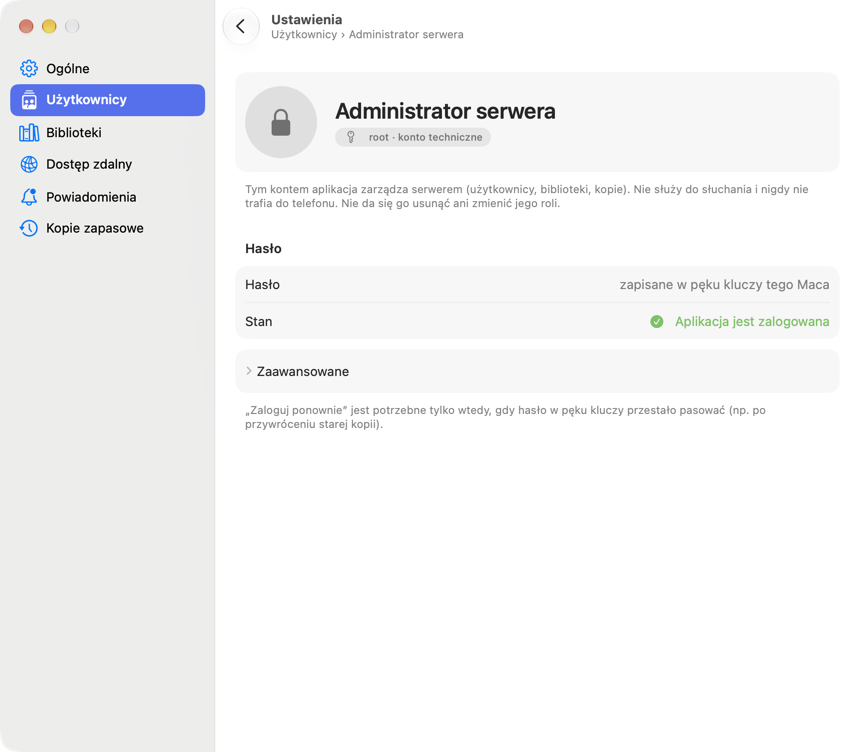 | 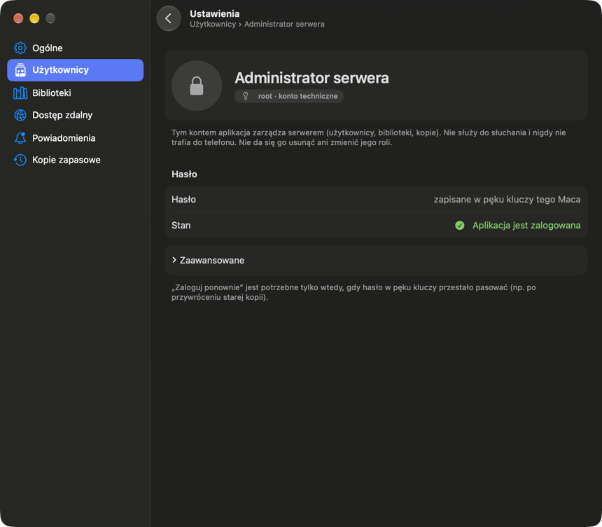 |

**Dostęp zdalny** (sekcja „Zaawansowane” zwinięta, ze streszczeniem)

| Jasny | Ciemny |
|---|---|
| 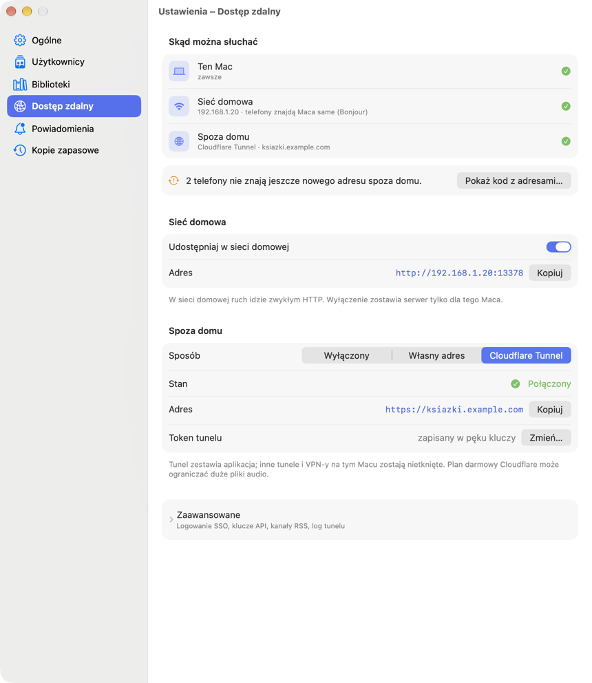 | 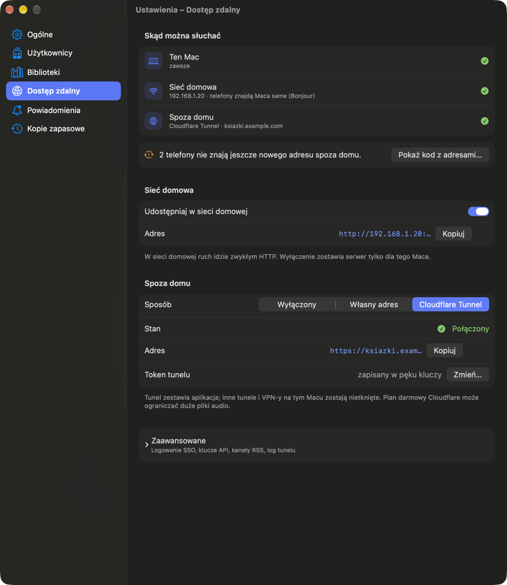 |

**Biblioteki** (sekcja „Zaawansowane” rozwinięta)

| Jasny | Ciemny |
|---|---|
| 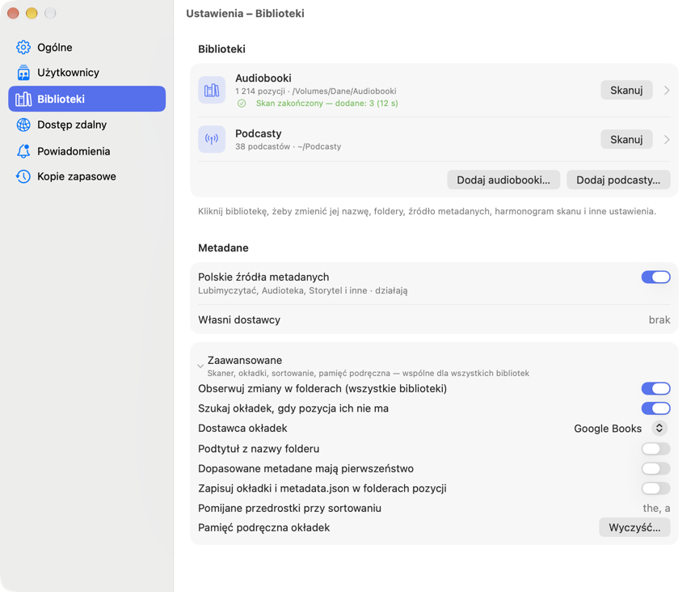 | 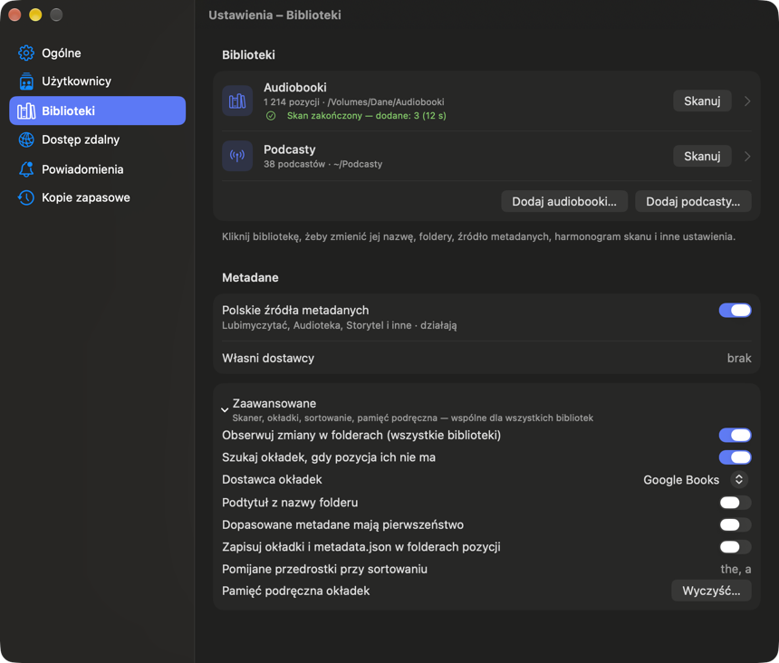 |

W makietach nie ma podstrony biblioteki, arkuszy „Podłącz telefon” i „Zarządzaj rolą i dostępem” ani stron Ogólne, Powiadomienia i Kopie. Ich zawartość to dzisiejsze kontrolki ułożone według zasad z części 2.

**Czego w makietach nie ma dziś w aplikacji** (zatwierdzenie wyglądu nie jest zatwierdzeniem tych prac):

- **„Ostatnio dziś” przy telefonie.** Serwer v2.38.0 nie zapisuje ostatniego użycia klucza. Dziś widać tylko datę sparowania.
- **„Słucha teraz …” na kaflu i w profilu.** Dane są (otwarte sesje), ale trzeba je pobierać dla siatki.
- **Liczba telefonów ze starymi adresami w banerze.** Mac nie wie, który telefon zeskanował kod. Wymaga zapamiętania „adresy zmieniły się po ostatnim pokazaniu kodu” albo zgłaszania wersji adresów przez telefon.
- **Awatary.** Kolor i inicjały liczone z nazwy nic nie kosztują. Wybór obrazka wymaga zapisu na Macu.
- **Statystyki w profilu** (godziny w roku, ukończone, dni z rzędu). API statystyk jest (arkusz US2), ale wybór trzech liczb jest nowy.
- **Przeciąganie kolejności bibliotek** zamiast przycisków Wyżej/Niżej.
- **„Dane logowania do innych aplikacji…”** jako osobny arkusz. Dane są te same co dziś w „Udostępnianiu”.

---

## 4. Kliknięcia w typowych zadaniach

Liczone od kliknięcia ikony na pasku menu (1). Tekstu nie liczę.

| Zadanie | Teraz | A | B | Uwagi |
|---|---|---|---|---|
| **Sparowanie telefonu** (sieć lokalna wyłączona) | 7: ikona › Ustawienia… › Udostępnianie › przełącznik sieci › Sparuj telefon… › Utwórz kod › odsłoń kod | 7 | **8**: ikona › Ustawienia… › Użytkownicy › konto Maca (albo prawy klik na kaflu) › Podłącz telefon… › pole „Włącz w sieci domowej” › Utwórz kod › odsłoń | Pole w arkuszu jest świadomym wyborem z ostrzeżeniem o HTTP i restarcie, a nie domyślnie zaznaczonym skutkiem ubocznym. Przy włączonej sieci: teraz 6, B 7. Opcja: „Podłącz telefon…” w menu na pasku daje **5** (4 przy włączonej sieci). |
| **Zmiana hasła konta Maca** | 5: ikona › Ustawienia… › Użytkownicy › ołówek › Zapisz | 6 | **6** przez profil albo menu kontekstowe kafla (prawy klik › Zmień hasło… › Zapisz) | Przy innych kontach tak samo. |
| **Skopiowanie hasła konta Maca do innej aplikacji** | 4: ikona › Ustawienia… › Udostępnianie › Kopiuj | 5 | **5** przez profil albo menu kontekstowe | |
| **Dodanie biblioteki** | 5: ikona › Ustawienia… › Biblioteki › Dodaj folder z audiobookami… › Otwórz | 5 | **5** | Dwa przyciski zostają. Menu „Dodaj bibliotekę ▾” dodałoby kliknięcie. |
| **Włączenie dostępu spoza domu** (tunel, `cloudflared` jest, token jeszcze nie) + aktualizacja adresów na telefonach | 7: ikona › Ustawienia… › Udostępnianie › Dostęp spoza domu › Cloudflare Tunnel › Zapisz (token) › Kod z adresami… | 7 | **6**: ikona › Ustawienia… › Dostęp zdalny › Cloudflare Tunnel (segment) › Zapisz (pole tokenu w wierszu) › baner „Pokaż kod z adresami…” | Przy zmianie istniejącego tokenu (arkusz „Zmień…”) B ma 7. Baner sam przypomina o telefonach. Dziś trzeba wiedzieć, że kod jest niżej w innej sekcji. |

Wariant B nie oszczędza kliknięć: w czterech zadaniach z pięciu jest tak samo albo o jedno więcej, bo dochodzi poziom „osoba”. Zyskiem jest to, gdzie rzeczy są, a nie ile trzeba kliknąć. Jeśli kliknięcia przy parowaniu mają znaczenie, rozwiązuje to skrót w menu na pasku (pytanie 5).

---

## 5. Tabela przejścia (100% pozycji spisu)

„→ skrót” oznacza przycisk prowadzący do jedynego miejsca albo otwierający ten sam arkusz, a nie drugą kopię kontrolek.

| ID | Teraz | Wariant B (rekomendowany) | Wariant A |
|---|---|---|---|
| M1 | Menu paska | bez zmian | bez zmian |
| M2 | Menu paska | bez zmian | bez zmian |
| M3 | Menu paska / aplikacji | bez zmian | bez zmian |
| M4 | Menu paska / aplikacji | bez zmian (nazwa okna „Ustawienia…”, pytanie 10) | bez zmian |
| M5 | Menu paska | bez zmian (skrót do G5) | bez zmian |
| M6 | Menu paska | bez zmian (skrót do G6) | bez zmian |
| M7 | Menu paska / aplikacji | bez zmian | bez zmian |
| M8 | Menu paska / aplikacji | bez zmian | bez zmian |
| G1 | Ogólne › Serwer | Ogólne › Serwer | Ogólne › Serwer |
| G2 | Ogólne › Serwer | Ogólne › Zaawansowane | Ogólne › Serwer |
| G3 | Ogólne › Serwer | Ogólne › Serwer | Ogólne › Serwer |
| G4 | Ogólne › Serwer | Ogólne › Zaawansowane (jedyne miejsce folderu danych) | Ogólne › Serwer |
| G5 | Ogólne › Serwer | Ogólne › Serwer | Ogólne › Serwer |
| G6 | Ogólne › Aplikacja | Ogólne › Aplikacja | Ogólne › Aplikacja |
| U1 | Udostępnianie › Połącz telefon | Dostęp zdalny › Sieć domowa (→ skrót: gdy nie ma żadnego adresu, arkusz „Podłącz telefon” pokazuje **niezaznaczone** pole „Włącz udostępnianie w sieci domowej” z ostrzeżeniem o zwykłym HTTP i restarcie serwera) | Dostęp zdalny › Sieć lokalna |
| U2 | Udostępnianie › Połącz telefon | Dostęp zdalny › Sieć domowa + „Skąd można słuchać” | Dostęp zdalny |
| U3 | Udostępnianie › Połącz telefon | Dostęp zdalny › Spoza domu + „Skąd można słuchać” | Dostęp zdalny |
| U4 | Udostępnianie › Połącz telefon | Użytkownicy › konto Maca › Hasło › „Dane logowania do innych aplikacji…” (arkusz: adres, nazwa, hasło) | Użytkownicy › profil |
| U5 | Udostępnianie › Połącz telefon | Użytkownicy › konto Maca › Hasło (Pokaż, Kopiuj) | Użytkownicy › profil |
| U6 | Udostępnianie › Połącz telefon | Dostęp zdalny › Spoza domu (segment) | Dostęp zdalny |
| U7 | Udostępnianie › Połącz telefon | Dostęp zdalny › Spoza domu › Własny adres | Dostęp zdalny |
| U8 | Udostępnianie › Cloudflare | Dostęp zdalny › Spoza domu › Cloudflare Tunnel | Dostęp zdalny |
| U9 | Udostępnianie › Cloudflare | Dostęp zdalny › Spoza domu › Token tunelu › „Zmień…” (arkusz z „Usuń token”) | Dostęp zdalny |
| U10 | Udostępnianie › Cloudflare | Dostęp zdalny › Spoza domu › Token tunelu: pole w wierszu przy pierwszym ustawieniu, „Zmień…” (arkusz z instrukcją), gdy token już jest | Dostęp zdalny |
| U11 | Udostępnianie › Cloudflare | Dostęp zdalny › Spoza domu › Stan + „Skąd można słuchać” | Dostęp zdalny |
| U12 | Udostępnianie › Cloudflare | Dostęp zdalny › Zaawansowane › Log tunelu | Dostęp zdalny |
| U13 | Udostępnianie › Cloudflare | Dostęp zdalny › Spoza domu (stopka i ostrzeżenie) | Dostęp zdalny |
| P1 | Udostępnianie › Telefon | Użytkownicy › konto Maca › Telefony (stopka); powód niedostępności w arkuszu | Użytkownicy › profil |
| P2 | Udostępnianie › Telefon | Użytkownicy › konto Maca › „Podłącz telefon…” (+ menu kontekstowe kafla) | Użytkownicy › profil |
| P3 | Udostępnianie › Telefon | Użytkownicy › konto Maca › Telefony | Użytkownicy › profil |
| P4 | Udostępnianie › Telefon | Użytkownicy › konto Maca › Telefony › „Odłącz…” | Użytkownicy › profil |
| P5 | Udostępnianie › Telefon | Użytkownicy › konto Maca › „Kod z adresami…” (→ skrót: baner w Dostępie zdalnym) | Użytkownicy › profil |
| P6 | Udostępnianie › Telefon | Użytkownicy › konto Maca › Rola i dostęp: wybór „Administrator” pyta o potwierdzenie (jak dziś „Nadaj…”) i działa jak `setListenerAdmin` (włącza też „Edycję pozycji”); „Użytkownik” odbiera bez pytania | Użytkownicy › profil |
| Z1 | Źródła metadanych | Biblioteki › Metadane | Metadane |
| Z2 | Źródła metadanych | Biblioteki › Metadane (podpis wiersza + „Spróbuj ponownie”) | Metadane |
| Z3 | Źródła metadanych | Biblioteki › Metadane › „Konfiguracja…” | Metadane |
| Z4 | Źródła metadanych | Biblioteki › Metadane › „Wyszukiwarka…” | Metadane |
| Z5 | Źródła metadanych | Biblioteki › Metadane › wiersz źródeł › „Log źródeł” (rozwijany) | Metadane |
| Z6 | Źródła metadanych | Biblioteki › Metadane › Własni dostawcy (wiersz → lista) | Metadane |
| Z7 | Źródła metadanych | Biblioteki › Metadane › Własni dostawcy › „Dodaj dostawcę…” | Metadane |
| L1 | Log serwera | Ogólne › Zaawansowane › Poziom logu | Ogólne › Dziennik serwera |
| L2 | Log serwera | Ogólne › Dziennik serwera (podstrona) | Ogólne › Dziennik serwera |
| L3 | Log serwera | Ogólne › Dziennik serwera | Ogólne › Dziennik serwera |
| L4 | Log serwera | usunięte jako duplikat G4; w Dzienniku zostaje „Pokaż w Finderze” pliku logu (→ skrót) | Ogólne › Dziennik serwera |
| L5 | Log serwera | Ogólne › Dziennik serwera | Ogólne › Dziennik serwera |
| B1 | Biblioteki | Biblioteki › Biblioteki (wiersz → podstrona) | Biblioteki |
| B2 | Biblioteki | Biblioteki › przeciąganie wierszy (+ podstrona biblioteki › Zaawansowane: Wyżej/Niżej dla dostępności) | Biblioteki |
| B3 | Biblioteki | „Skanuj” w wierszu; pełny skan i „Dopasuj wszystkie…” na podstronie biblioteki | Biblioteki |
| B4 | Biblioteki (arkusz) | Biblioteki › <biblioteka> (podstrona zamiast arkusza) | Biblioteki (arkusz bez zmian) |
| B5 | Biblioteki | Biblioteki › <biblioteka> › „Usuń bibliotekę…” na dole | Biblioteki |
| B6 | Biblioteki | Biblioteki › „Dodaj audiobooki…” | Biblioteki |
| B7 | Biblioteki | Biblioteki › „Dodaj podcasty…” | Biblioteki |
| B8 | Biblioteki | Biblioteki › wiersz biblioteki (stan) | Biblioteki |
| B9 | Biblioteki | Użytkownicy › Administrator serwera › „Zaloguj ponownie hasłem…”; na innych stronach baner z przyciskiem do tego miejsca (→ skrót) | Użytkownicy › root |
| BS1 | Arkusz biblioteki | <biblioteka> › Biblioteka | arkusz bez zmian |
| BS2 | Arkusz biblioteki | <biblioteka> › Biblioteka | arkusz bez zmian |
| BS3 | Arkusz biblioteki | <biblioteka> › Biblioteka (domyślne źródło) | arkusz bez zmian |
| BS4 | Arkusz biblioteki | <biblioteka> › Biblioteka (podcasty) | arkusz bez zmian |
| BS5 | Arkusz biblioteki | <biblioteka> › Foldery | arkusz bez zmian |
| BS6 | Arkusz biblioteki | <biblioteka> › Wyświetlanie | arkusz bez zmian |
| BS7 | Arkusz biblioteki | <biblioteka> › Skanowanie („Obserwuj zmiany w tej bibliotece”, z dopiskiem o ustawieniu globalnym) | arkusz bez zmian |
| BS8 | Arkusz biblioteki | <biblioteka> › Zaawansowane | arkusz bez zmian |
| BS9 | Arkusz biblioteki | <biblioteka> › Wyświetlanie | arkusz bez zmian |
| BS10 | Arkusz biblioteki | <biblioteka> › Wyświetlanie | arkusz bez zmian |
| BS11 | Arkusz biblioteki | <biblioteka> › Zaawansowane | arkusz bez zmian |
| BS12 | Arkusz biblioteki | <biblioteka> › Zaawansowane | arkusz bez zmian |
| BS13 | Arkusz biblioteki | <biblioteka> › Zaawansowane | arkusz bez zmian |
| BS14 | Arkusz biblioteki | <biblioteka> › Zaawansowane | arkusz bez zmian |
| BS15 | Arkusz biblioteki | <biblioteka> › Skanowanie (wspólny komponent harmonogramu z KZ4) | arkusz bez zmian |
| BS16 | Arkusz biblioteki | <biblioteka> › Słuchanie („Oznacz jako ukończone”) | arkusz bez zmian |
| BS17 | Arkusz biblioteki | <biblioteka> › Zaawansowane | arkusz bez zmian |
| K1 | Konta | Użytkownicy › kafel/profil konta Maca (zakładanie: kafel „Utwórz konto tego Maca”) | Użytkownicy |
| K2 | Konta | Użytkownicy › Administrator serwera | Użytkownicy › root |
| K3 | Konta | Użytkownicy › Administrator serwera › Zaawansowane › „Zaloguj ponownie hasłem…” | Użytkownicy › root |
| US1 | Użytkownicy | Użytkownicy › siatka profili | Użytkownicy › siatka |
| US2 | Użytkownicy (arkusz) | profil › Słuchanie › „Statystyki i sesje…” | profil |
| US3 | Użytkownicy (arkusz) | profil: nazwa → Zaawansowane; hasło → Hasło › „Zmień…”; typ → Rola i dostęp; aktywne → Zaawansowane | profil |
| US4 | Użytkownicy (arkusz) | profil › Rola i dostęp › „Zarządzaj rolą i dostępem…” | profil |
| US5 | Użytkownicy (arkusz) | profil › Rola i dostęp › „Zarządzaj rolą i dostępem…” | profil |
| US6 | Użytkownicy (arkusz) | profil › Zaawansowane › Dostęp według tagów | profil |
| US7 | Użytkownicy | profil › „Usuń konto…” na dole | profil |
| US8 | Użytkownicy | Użytkownicy › kafel „Dodaj osobę” | Użytkownicy |
| S1 | Ustawienia serwera › Skaner | Biblioteki › Zaawansowane | Metadane |
| S2 | Ustawienia serwera › Skaner | Biblioteki › Zaawansowane | Metadane |
| S3 | Ustawienia serwera › Skaner | Biblioteki › Zaawansowane | Metadane |
| S4 | Ustawienia serwera › Skaner | Biblioteki › Zaawansowane | Metadane |
| S5 | Ustawienia serwera › Skaner | Biblioteki › Zaawansowane („…we wszystkich bibliotekach”) | Metadane |
| S6 | Ustawienia serwera › Metadane | Biblioteki › Zaawansowane | Serwer |
| S7 | Ustawienia serwera › Metadane | Biblioteki › Zaawansowane | Serwer |
| S8 | Ustawienia serwera › Sortowanie | Biblioteki › Zaawansowane | Serwer |
| S9 | Ustawienia serwera › Sortowanie | Biblioteki › Zaawansowane | Serwer |
| S10 | Ustawienia serwera › Język | Ogólne › Zaawansowane › Język serwera | Serwer |
| S11 | Ustawienia serwera › Pamięć | Biblioteki › Zaawansowane › Pamięć podręczna okładek | Serwer |
| S12 | Ustawienia serwera › Pamięć | Biblioteki › Zaawansowane › Pamięć podręczna (Wyczyść… → wybór: okładki / wszystko) | Serwer |
| D1 | Dostęp › Klucze API | Dostęp zdalny › Zaawansowane › Klucze API (klucze telefonów oznaczone, „Odłącz” prowadzi do profilu) + profil › Zaawansowane (filtr kluczy tej osoby) | Logowanie i klucze |
| D2 | Dostęp › Klucze API | Dostęp zdalny › Zaawansowane › Klucze API › „Nowy klucz…” | Logowanie i klucze |
| D3 | Dostęp › Klucze API | jak D2 (arkusz z sekretem) | Logowanie i klucze |
| D4 | Dostęp › Logowanie | Dostęp zdalny › Zaawansowane › Logowanie (SSO) | Logowanie i klucze |
| D5 | Dostęp › Logowanie | Dostęp zdalny › Zaawansowane › Logowanie › „Skonfiguruj OpenID…” (arkusz) | Logowanie i klucze |
| D6 | Dostęp › Logowanie | jak D5 (sekcja „Więcej” w arkuszu) | Logowanie i klucze |
| D7 | Dostęp › Logowanie | Dostęp zdalny › Zaawansowane › Wiadomość na stronie logowania | Logowanie i klucze |
| D8 | Dostęp › Logowanie | arkusz OpenID: Anuluj/Zapisz | Logowanie i klucze |
| AK1 | Aktywność › Sesje | Użytkownicy: „słucha teraz” na kaflu i profilu + „Historia słuchania wszystkich…” › Otwarte teraz | Aktywność |
| AK2 | Aktywność › Sesje | profil › „Statystyki i sesje…” (sesje tej osoby) + „Historia słuchania wszystkich…” (z filtrem) | Aktywność |
| AK3 | Aktywność › Kanały RSS | Dostęp zdalny › Zaawansowane › Publiczne kanały RSS | Aktywność |
| N1 | Powiadomienia › Apprise | Powiadomienia › Apprise (adres); limity → Zaawansowane | Powiadomienia i e-mail |
| N2 | Powiadomienia | Powiadomienia › Powiadomienia | Powiadomienia i e-mail |
| N3 | Powiadomienia (arkusz) | Powiadomienia › „Nowe powiadomienie…” | Powiadomienia i e-mail |
| N4 | E-mail i czytniki | Powiadomienia › Zaawansowane › „Serwer poczty (SMTP)…” (arkusz) | Powiadomienia i e-mail |
| N5 | E-mail i czytniki | Powiadomienia › E-mail na czytniki | Powiadomienia i e-mail |
| KZ1 | Kopie zapasowe | Kopie zapasowe › Kopie | Kopie zapasowe |
| KZ2 | Kopie zapasowe | Kopie zapasowe › Kopie | Kopie zapasowe |
| KZ3 | Kopie zapasowe | Kopie zapasowe › Kopie | Kopie zapasowe |
| KZ4 | Kopie zapasowe | Kopie zapasowe › Automatyczne (cron → Zaawansowane) | Kopie zapasowe |
| KZ5 | Kopie zapasowe | Kopie zapasowe › Zaawansowane | Kopie zapasowe |
| KZ6 | Kopie zapasowe | Kopie zapasowe › Zaawansowane | Kopie zapasowe |
| X1 | Okno powitalne | bez zmian | bez zmian |
| X2 | Okno źródeł | bez zmian (otwierane z Biblioteki › Metadane) | bez zmian (z „Metadane”) |
| X3 | Okno Biblioteka | bez zmian | bez zmian |
| X4 | Okno Biblioteka | bez zmian | bez zmian |
| X5 | Okna czytnika, tekstu, biblioteki | bez zmian | bez zmian |
| X6 | Okno Biblioteka, web UI | cel: Ogólne (bez zmian) albo Ogólne › Dziennik serwera | cel: Ogólne |
| X7 | Wysyłka na czytnik | cel: Powiadomienia › E-mail na czytniki | cel: Powiadomienia i e-mail |
| X8 | Okna Biblioteka, web UI | bez zmian (ten sam formularz co kafel „Utwórz konto tego Maca”) | bez zmian |

Kontrola kompletności: każdy identyfikator ze spisu (1.3) występuje w tej tabeli dokładnie raz. Sprawdza to skrypt w [`ustawienia-nowy-uklad/sprawdz-tabele.sh`](ustawienia-nowy-uklad/sprawdz-tabele.sh).

---

## 6. Plan wdrożenia (wariant B)

Każdy etap kończy się spójną aplikacją: nowa strona przejmuje pozycje, a stara znika w tym samym etapie. Nie ma okresu, w którym coś jest w dwóch miejscach albo nigdzie.

**Etap 1 — fundament (bez widocznych zmian w treści)** — ✅ wykonany (część 10)

- **Nawigacja:** `SettingsNavigation` dostaje ścieżkę podstron (`NavigationStack` w szczegółach) i cele typu `.user(id)`, `.library(id)`, `.serverLog`. Ostatnia strona zapisywana jest w `@AppStorage`.
- **Wspólne komponenty:** wiersz obiektu z chevronem, sekcja „Zaawansowane” (zwinięta, ze streszczeniem), jeden komponent harmonogramu (dziś BS15 i KZ4), wiersz hasła (Pokaż/Kopiuj/Zmień), baner z akcją.
- **Okno ustawień:** tytuł „Ustawienia”, bez zmian w treści stron.
- **Do sprawdzenia:** wszystkie wejścia `openSettings(...)` (menu, okno biblioteki, web UI, wysyłka na czytnik) otwierają właściwą stronę, a strona przetrwa ponowne uruchomienie.

**Etap 2 — Użytkownicy (największy)** — ✅ wykonany (2a, 2b, 2c bez resetu hasła, 2d na Macu; część 10)

- **Zakres:** siatka profili, profil, strona roota, arkusze „Podłącz telefon”, „Zarządzaj rolą i dostępem”, „Zmień hasło”, „Dane logowania” i menu kontekstowe kafla.
- **Znikają:** strona „Konta” i sekcja telefonu z „Udostępniania”. „Udostępnianie” zostaje tylko z siecią i tunelem, pod nazwą „Dostęp zdalny”.
- **Uprawnienia administratora konta Maca:** jedna kontrolka. Rola zastępuje „Nadaj…/Odbierz” i zablokowany typ w edytorze. Wybór „Administrator” zachowuje potwierdzenie i działanie `setListenerAdmin` (typ `admin` + „Edycja pozycji”).
- **Pozostałe zmiany:** znak uwagi z „Kont” przechodzi na „Użytkowników”, a teksty w aplikacji, które dziś odsyłają do „Kont”, odsyłają do roota w „Użytkownikach”. Teksty iOS — patrz część 7.
- **Ryzyka:**
  - `PhonePairing.refresh` jest dziś wywoływane z `.task(id: listenerUsername)` w sekcji. Musi się przenieść do profilu.
  - Arkusz parowania czyści klucz z pamięci w `onDisappear`. Powrót z profilu zamyka arkusz i to jest dobre, ale trzeba to sprawdzić.
  - `UsersModel` i `ServerAccount` mają osobne pojęcie słuchacza (`isListener`, `listenerRevision`, `listenerCredentialsChanged`). Profil musi korzystać z obu tak samo jak dziś edytor.
  - Usunięcie i zmiana nazwy słuchacza w trakcie odtwarzania.
  - Pole „Włącz udostępnianie w sieci domowej” w arkuszu parowania restartuje serwer. Arkusz musi poczekać na restart, zanim złoży kod z adresami, i pokazać, że to trwa.
- **Do sprawdzenia ręcznie:**
  - telefon: parowanie z siecią wyłączoną (włączenie z arkusza), odłączenie, kod z adresami,
  - konto Maca: nadanie i odebranie administratora, zmiana hasła i nazwy w trakcie odtwarzania, usunięcie (prośba o nowe konto),
  - zwykły użytkownik: dodanie z ograniczeniami,
  - root: nie da się edytować ani usunąć,
  - VoiceOver na siatce, bo kafle to przyciski z etykietą.

**Etap 3 — Dostęp zdalny**

- **Zakres:** podsumowanie „Skąd można słuchać”, baner telefonów, segment spoza domu, token w arkuszu.
- **Pod „Zaawansowane”:** zawartość strony „Dostęp” (klucze, SSO), kanały RSS z „Aktywności” i log tunelu.
- **Znika:** strona „Dostęp”.
- **Ryzyka:**
  - `AdminPage` trzyma modele kart w stanie strony. Po przeniesieniu do sekcji rozwijanych trzeba nie ładować ich przed rozwinięciem.
  - Formularz OpenID jest długi, a jego przeniesienie do arkusza zmienia sposób zapisu.
  - Baner potrzebuje wiedzy, które telefony mają stare adresy. Dziś jej nie ma. Pierwsza wersja może pokazywać baner po każdej zmianie adresów do czasu pokazania kodu. To założenie, sprawdzić z zachowaniem iOS.
- **Do sprawdzenia:** włączenie i wyłączenie sieci domowej (restart serwera), własny adres, tunel z tokenem testowym (bez ruszania tunelu użytkownika), klucze API: klucz telefonu oznaczony i nie da się go przypadkiem usunąć bez ostrzeżenia, OpenID zapis i przywrócenie.

**Etap 4 — Biblioteki**

- **Zakres:**
  - arkusz biblioteki staje się podstroną,
  - na stronę „Biblioteki” trafiają „Źródła metadanych” oraz skaner, okładki, sortowanie i pamięć podręczna z „Ustawień serwera” (pod „Zaawansowane”),
  - przeciąganie kolejności.
- **Znikają:** strony „Źródła metadanych” i (prawie całe) „Ustawienia serwera”.
- **Ryzyka:**
  - `LibrariesSettingsPage` steruje cyklem `libraryTasks.appear()/disappear()`, a połączenie root rozłącza się ok. 6 s po wyjściu z „Bibliotek” (notatka etapu 9c). Wejście w podstronę biblioteki nie może tego cyklu przerwać.
  - `LibrarySection` jest wspólny z oknem powitalnym, więc okno powitalne musi zostać nietknięte.
  - Zapis w arkuszu biblioteki działa przez „Zapisz”, a na stronie zapis będzie natychmiastowy. Trzeba sprawdzić model `LibrarySettingsModel` pod kątem zapisu pojedynczych pól.
- **Do sprawdzenia:** dodanie obu typów bibliotek, skan, pełny skan, dopasuj wszystkie, usunięcie, zmiana ustawień biblioteki i harmonogramu, obserwator globalny i per biblioteka, polskie źródła i własny dostawca.

**Etap 5 — Ogólne, Dziennik, Aktywność**

- **Zakres:**
  - Dziennik jako podstrona Ogólnych,
  - poziom logu, język serwera, wersja i folder danych pod „Zaawansowane”,
  - historia sesji przy profilach i jako „Historia słuchania wszystkich…”,
  - „słucha teraz” na kaflach.
- **Znikają:** strony „Log serwera”, „Ustawienia serwera” (reszta) i „Aktywność”.
- **Ryzyko:** strona błędu serwera otwiera dziś „Ogólne”, a `AudiobookSwiftApp` otwiera je sam przy `.failed`. Musi to zostać.
- **Do sprawdzenia:** błąd startu (np. zajęty port) pokazuje się z logiem, przewijanie dziennika, kopiowanie, zamknięcie otwartej sesji, usunięcie sesji z historii.

**Etap 6 — Powiadomienia, Kopie, porządki**

- **Zakres:**
  - Powiadomienia bez kart, SMTP w arkuszu pod „Zaawansowane”,
  - Kopie z „Zaawansowane”,
  - przegląd słownictwa w całej aplikacji (README, napisy pomocy, komunikaty błędów),
  - nowe zrzuty do README,
  - porównanie ze spisem: wszystkie 124 pozycje na miejscu.
- **Do sprawdzenia:** powiadomienie testowe, e-mail testowy, czytnik, kopia, przywrócenie, harmonogram, zmiana folderu kopii.

**Wariant A** to etapy 1, 2 i 5 (bez Aktywności) oraz uproszczony etap 3 (tylko zmiana nazwy „Udostępniania”).

**Ogólne ryzyka**

- Zmiany tekstów odsyłających do stron. W kodzie Maca jest 10 plików z nazwami stron, m.in. `BackupsSettingsPage`, `AccessSettingsPage`, `UsersModel`, `SharingController`, `ShareSheets` i README.
- Jedna wspólna nazwa procesu testowej i prawdziwej kopii (automatyzacja po PID).
- Testy UI dziś nie istnieją dla ustawień, więc każdy etap wymaga przeklikania. Dobrze byłoby dodać prosty test, który otwiera każdą stronę.

## 7. Wpływ na klienta iOS

**Protokół się nie zmienia.** `PairingPayload` (nazwa serwera, adresy, konto, urządzenie, klucz), przedrostek nazwy klucza telefonu (`PhonePairing.keyPrefix`, po nim lista rozpoznaje telefony) i „Kod z adresami” zostają bez zmian. **Przedrostka nie wolno zmieniać**, bo już sparowane telefony zniknęłyby z listy.

**Zmieniają się teksty pomocy w iOS, które opisują drogę na Macu:**

| Plik iOS | Dziś | Po zmianie (wariant B) |
|---|---|---|
| `WelcomeView.swift:24` | „Ustawienia aplikacji → Udostępnianie → „Sparuj telefon…”” | „Ustawienia → Użytkownicy → (konto Maca) → „Podłącz telefon…”” |
| `WelcomeView.swift:88` | adres „w Ustawieniach → Udostępnianie”; klucz API „na podstronie „Dostęp”” | „Ustawienia → Dostęp zdalny”; „Dostęp zdalny → Zaawansowane → Klucze API” |
| `SettingsView.swift:98` | „Ustawienia aplikacji → Udostępnianie → „Kod z adresami…”” | „Ustawienia → Dostęp zdalny → „Pokaż kod z adresami…” (albo profil konta Maca)” |
| `PodcastStore.swift:175, 177` | „Udostępnianie → Aplikacja AudiobookSwift na telefonie → Uprawnienia administratora → „Nadaj…”” | „Użytkownicy → (konto Maca) → Rola: Administrator” (włącza też „Edycję pozycji”) |
| `SettingsView.swift:104`, `PairedServer.swift:62`, `AudiobookSwiftiOSApp.swift:75` | „usuń telefon z listy sparowanych”, „unieważniony na Macu” | słownictwo „odłącz” („Odłącz telefon na Macu”) |

**Starsze wersje aplikacji iOS** będą pokazywać stare ścieżki do czasu aktualizacji. Proponuję:

- zmieniać teksty iOS w tym samym etapie co Maca (etap 2 dla parowania i uprawnień, etap 3 dla adresów),
- pisać je ogólniej („na Macu w ustawieniach AudiobookSwift, przy swoim profilu”), żeby przetrwały przyszłe drobne zmiany,
- opcjonalnie dodać do okna ustawień Maca pole wyszukiwania (`.searchable`), które znajdzie też stare nazwy („Udostępnianie”, „Sparuj”, „Konta”) i przeniesie do nowego miejsca.

## 8. Pytania do użytkownika

1. ~~**Wariant B czy A?**~~ Rozstrzygnięte: **wariant B**.
2. **Nagłówek siatki** „Kto słucha?” (jak w makiecie) czy bez nagłówka, sam tytuł „Użytkownicy”?
3. **Awatary:** gradient z inicjałami (makieta), wybór z kilku symboli lub emoji, czy zdjęcie? Audiobookshelf nie trzyma awatarów, więc byłyby zapisane tylko na Macu i nie trafiłyby do telefonu.
4. **Kafel roota:** pod siatką (makieta) czy całkiem schowany pod „Zaawansowane” na stronie Użytkownicy?
5. ~~**„Podłącz telefon…” także w menu na pasku menu?**~~ Rozstrzygnięte w części 9 (opcja, domyślnie wyłączona). Skraca parowanie do 4 kliknięć.
6. **Pasek boczny czy pasek narzędzi z 6 ikonami** (styl Safari/Mail, zalecany przez HIG dla okien ustawień)? Rekomenduję pasek boczny ze względu na podstrony osób i bibliotek.
7. ~~**Telefony innych domowników:**~~ Rozstrzygnięte w części 9 (tak). dziś telefon paruje się tylko z kontem Maca. Czy chcesz parowania telefonu np. Tomka do jego konta? To nowa funkcja `PhonePairing`.
8. ~~**Konto root:**~~ Rozstrzygnięte w części 9 (pełna kontrola). Pierwotnie: zostawić tylko „Zaloguj ponownie hasłem…”, czy dodać „Pokaż/Kopiuj hasło” (jest w pęku kluczy) albo „Zmień hasło roota” (nowa funkcja)?
9. **Słownictwo:** „Podłącz/Odłącz telefon” zamiast „Sparuj/Unieważnij”, „Dostęp zdalny” zamiast „Udostępnianie”, „Dziennik serwera” zamiast „Log serwera”. Pasuje?
10. **Nazwa okna:** „Ustawienia” zamiast „Ustawienia aplikacji”, bo grupa „Serwer audiobookshelf” znika i podział aplikacja/serwer przestaje być potrzebny.


## 9. Decyzje z 2026-11-23 i ich skutki

| Pytanie | Decyzja | Skutek dla projektu |
|---|---|---|
| 1. Wariant | **B** | Plan z części 6 bez zmian w kolejności. |
| 7. Telefony innych domowników | **Tak, dla każdego konta** („inaczej nie podłączę dziewczyny”) | Sekcja „Telefony” na każdym profilu, nie tylko konta Maca. |
| 8. Konto root | **Pełna kontrola: zmiana i reset hasła**, skoro web UI jest schowane | Strona roota przestaje być tylko do odczytu. |
| 5. „Podłącz telefon…” na pasku menu | **Nie domyślnie; najwyżej jako opcja** | Przełącznik w Ogólne › Aplikacja, domyślnie wyłączony. Niski priorytet (etap 6). |
| 2, 4 (wygląd siatki, kafel roota) | **Jak w makietach** | Nagłówek „Kto słucha?”, kafel roota pod siatką. |
| 3. Awatary | **Własne awatary — pytanie, czy się da** | Da się, ale tylko po stronie Maca (niżej). |

**Telefony dla każdego domownika (etap 2b)**

- **Mechanizm jest ten sam.** Root tworzy klucz API dla wybranego konta z tym samym przedrostkiem nazwy, a kod QR niesie identyfikator i nazwę tego konta (`PairingPayload.account`). Format kodu się nie zmienia. Telefon loguje się jako ta osoba i ma jej własny postęp.
- **Zmiany na Macu:**
  - `PhonePairing` dostaje parametr konta zamiast stałego „słuchacza”,
  - lista urządzeń filtruje klucze po `userId` profilu,
  - „Kod z adresami” obejmuje telefony wszystkich kont (adresy są wspólne),
  - baner w „Dostępie zdalnym” liczy telefony wszystkich osób.
- **Uprawnienie do pobierania odcinków z telefonu** (administrator + „Edycja pozycji”) staje się ustawieniem roli każdej osoby. Dla innych niż konto Maca zostaje to samo potwierdzenie i wyjaśnienie, że administrator zarządza całym serwerem.
- **Konto „Gość”:** parowanie dozwolone, ale bez pytania o administratora.
- **Hasło innych osób:** serwer go nie zwraca, więc „Pokaż/Kopiuj” jest tylko dla konta Maca i roota. Telefon z aplikacją AudiobookSwift hasła nie potrzebuje. Dla innych aplikacji audiobookshelf (np. dziewczyna z oficjalną aplikacją) jest „Zmień…” i „Dane logowania…” pokazujące nowe hasło raz, zaraz po zmianie.
- **iOS:**
  - Protokół bez zmian.
  - Tekst w `PodcastStore` ma mówić o profilu tej osoby, nie „koncie Maca”.
  - Do sprawdzenia: czy klient iOS nie zakłada gdzieś, że konto z kodu to konto Maca (np. komunikaty z nazwą „konto do słuchania”).
- **Ryzyko:** klucz telefonu daje dostęp do konta bez hasła. Lista telefonów każdej osoby musi być równie widoczna jak dziś lista konta Maca, a „Odłącz” działać od razu.

**Root: zmiana i reset hasła (etap 2c)**

- **„Zmień…”:** serwer ma `PATCH /api/me/password` (stare i nowe hasło) dla zalogowanego konta. Aplikacja zna stare hasło z pęku kluczy, więc zmiana to jedno pole. Puste pole oznacza losowe, tak jak przy zakładaniu konta. Nowe hasło trafia od razu do pęku kluczy. Kolejność: najpierw zmiana na serwerze, potem pęk kluczy, a przy błędzie zapisu do pęku pokazać hasło do przepisania.
- **„Pokaż / Kopiuj”:** hasło jest w pęku kluczy, więc to tylko interfejs. Odsłonięcie zakrywa się samo po minucie, jak kod parowania.
- **„Zresetuj hasło…”:** gdy hasła nie ma albo nie pasuje (np. po przywróceniu starej kopii albo przeniesieniu folderu danych na innego Maca). Serwer nie ma resetu przez API.
  - Aplikacja zarządza serwerem, więc może: zatrzymać serwer, zapisać nowy skrót bcrypt w kolumnie `pash` roota w bazie SQLite folderu danych, uruchomić serwer i zalogować się nowym hasłem.
  - To ingerencja w bazę serwera, więc musi mieć potwierdzenie, kopię bazy przed zmianą i test na kopii danych.
  - **Ryzyko większe niż reszta etapu.** Sprawdzone w kodzie serwera: hasła są w bcrypt (`server/auth/LocalAuthStrategy.js`, `hashPassword` i `bcrypt.compare` z dołączonego `bcryptjs`), a `User.cache` to pamięć podręczna w procesie (`LRUCache`), więc przy zatrzymanym serwerze nie przeszkadza. Do sprawdzenia przy wdrożeniu: zgodność skrótu wygenerowanego po stronie Swifta z `bcryptjs` (koszt, prefiks `$2a$`/`$2b$`) albo wygenerowanie go dołączonym Node.
- **Web UI zarządzania** (⌥ przy „Ustawieniach…”) zostaje jako wyjście awaryjne, bez zmian.

**Własne awatary (etap 2d, opcjonalny)**

- **Serwer audiobookshelf nie ma awatarów:** model `User` nie ma takiego pola, a `extraData` jest z API niezmienialne. Awatar musi więc żyć po stronie Maca.
- **Propozycja:** plik `avatars/<id-konta>.png` w folderze danych aplikacji, obok `sharing.json`. Folder danych to jedno miejsce, które przenosi się razem z serwerem.
- **Wybór:**
  - zdjęcie (przeciągnięcie albo panel „Otwórz”, przycięcie do koła),
  - jeden z kilkunastu symboli lub emoji na kolorowym tle,
  - domyślnie gradient z inicjałami jak w makiecie.
- **Ograniczenia:**
  - Kopia zapasowa audiobookshelf awatarów nie obejmie, bo serwer tworzy kopie z własnej bazy i metadanych. Trzeba to napisać przy wyborze awatara albo dopisać folder do kopii po stronie aplikacji.
  - Telefony nie zobaczą awatara, chyba że później dodamy go do kodu parowania albo do lekkiego zapytania o profil. To osobna, opcjonalna praca.
- **Koszt:** mały, niezależny od reszty, można dodać po etapie 2.
- **iOS (decyzja 2026-11-23): później, po Macu, tylko kosmetycznie.** Telefon nie przełącza użytkowników, więc awatar pokazuje się np. w ekranie ustawień aplikacji jako „to konto”. Telefon rozmawia tylko z serwerem audiobookshelf, który awatarów nie ma, więc trzeba wybrać drogę:
  - **symbol lub emoji z kolorem w kodzie parowania i w „Kodzie z adresami”**: kilka bajtów, bez zmian w serwerze; zdjęcie się nie zmieści w kodzie QR;
  - **zdjęcie**: wymaga osobnego kanału, np. małego pliku, który Mac wystawia obok serwera, albo przesłania przy parowaniu po sieci lokalnej. To większa praca, do decyzji przy etapie iOS.
  - Pole w `PairingPayload` musi być opcjonalne, żeby starsze wersje iOS czytały nowe kody, a nowe iOS stare kody.

**Zmiany w planie (część 6)**

Etap 2 dzieli się na:

- **2a:** siatka, profile, strona roota i przeniesienie istniejących funkcji. Bez nowej funkcjonalności.
- **2b:** telefony dla każdego konta.
- **2c:** zmiana, podgląd i reset hasła roota.
- **2d:** własne awatary.

Etapy 2b–2d są od siebie niezależne. Do etapu 6 dochodzi opcja „Pokaż „Podłącz telefon…” na pasku menu”. Do spisu dochodzą nowe pozycje bez starego miejsca: parowanie dla innych kont, hasło roota (pokaż/kopiuj/zmień/resetuj), awatar i opcja skrótu. Nie są w tabeli przejścia, bo dziś nie istnieją.


## 10. Wdrożenie etapów 1 i 2

Gałąź `claude/ustawienia-etap-1-2-uzytkownicy-631ae4`, 2026-11-23. Nie scalona z `main`.

**Etap 1.** `SettingsNavigation` ma ścieżkę podstron (`NavigationStack` w szczegółach) i miejsca `SettingsDestination` (`.user(id)`, `.root`, `.library(id)`, `.serverLog`; dwa ostatnie do etapów 4 i 5 otwierają swoją stronę). Ostatnia strona jest w UserDefaults (`settings.lastPage`), odczyt jest tolerancyjny (`accounts` → `users`, nieznana → Ogólne). Ścieżka podstron nie jest zapamiętywana — obiekt mógł w tym czasie zniknąć. Okno nazywa się „Ustawienia”. Wspólne komponenty są w `UI/Settings/SettingsComponents.swift`: `ObjectRow`, `AdvancedSection` (cały nagłówek jest przyciskiem), `ScheduleRows` (BS15 i KZ4; zapis zostaje po stronie wywołującego), `PasswordRow`, `ActionBanner`. Tryb sprawdzający: argument `-ABSSettingsTour YES` otwiera po kolei każdą stronę, profil każdej osoby i stronę roota, a na koniec wypisuje `TOUR OK`.

**Etap 2.** Strona „Użytkownicy” (`UI/Users/`): siatka, profil, root, arkusze. „Konta” i sekcja telefonu z „Udostępniania” zniknęły, a „Udostępnianie” nazywa się „Dostęp zdalny”.

### Zrzuty (testowa kopia, zmyślone konta)

W [`ustawienia-nowy-uklad/wdrozenie-png/`](ustawienia-nowy-uklad/wdrozenie-png/), każdy w wersji `-light` i `-dark`:

- `uzytkownicy`
- `profil-konto-maca`
- `profil-osoby`, `profil-osoby-dol` (z rozwiniętym „Zaawansowane”)
- `arkusz-podlacz-telefon` (sieć domowa wyłączona)
- `root`
- `dostep-zdalny`

Wersje jasne są wymuszone argumentem `-NSRequiresAquaSystemAppearance YES`, bo system był w trybie ciemnym. Okno na jasnych zrzutach jest nieaktywne, stąd szare przyciski.

### Odstępstwa od części 3–6 i 9

- **Rola: trzy segmenty** (Gość / Użytkownik / Administrator) zamiast dwóch z makiety, bo inaczej „Gość” (US3) nie miałby miejsca. Konto Maca ma dwa: gość nie zmieni sam hasła, a aplikacja zakłada dla Maca zwykłe konto.
- **Przycisk „Zarządzaj dostępem…”** zamiast „Zarządzaj rolą i dostępem…”. Rola jest na samym profilu, a arkusz zawiera tylko uprawnienia i biblioteki, więc rola nie występuje w dwóch miejscach.
- **„Nazwa konta”** jest w „Zaawansowane” jako pole z „Zmień nazwę”, nie jako arkusz.
- **„Kod z adresami…” na stronie „Dostęp zdalny”** jest zwykłym przyciskiem, a nie banerem z liczbą telefonów (baner to etap 3). Otwiera ten sam arkusz co profil. Dzięki temu tekst iOS z części 7 mógł od razu wskazywać „Dostęp zdalny”.
- **Teksty iOS z etapu 3** (`WelcomeView` o adresie, `SettingsView` o kodzie z adresami) zmieniły się już teraz, bo nazwa strony zmieniła się w etapie 2. Klucze API dalej są na stronie „Dostęp” (do etapu 3).
- **Usuwanie konta:** potwierdzenie powtarza nazwę konta w tytule i na przycisku, bez wpisywania nazwy.
- **Odznaka „Słucha teraz”, „ostatnio dziś”, statystyki w profilu i „Historia słuchania wszystkich…”** nie zostały wdrożone: to etap 5 albo praca niezatwierdzona. Profil ma „Statystyki słuchania…” (US2) i „Ostatnio: …” z `lastSeen`.
- **Klucze API tej osoby w „Zaawansowane”** (filtr D1) nie zostały wdrożone, bo D1 przechodzi w etapie 3.
- **B9** (formularz hasła roota na stronie „Biblioteki”) zostaje bez zmian, bo `LibrarySection` dzieli go z oknem powitalnym (etap 4). Inne strony administracyjne zamiast tekstu „podaj hasło na podstronie »Konta«” mają baner z przyciskiem do strony roota.
- **2c: reset hasła roota przez bazę** nie został zrobiony (część 9, „ryzyko większe niż reszta etapu”). Jest „Pokaż / Kopiuj / Zmień…” (`PATCH /api/me/password`, najpierw serwer, potem pęk kluczy) i „Zaloguj ponownie hasłem…”.
- **2d:** awatar to symbol na kolorze, zdjęcie (środek przycięty do kwadratu, 256 px) albo inicjały. Pliki leżą w `avatars/` folderu danych. Arkusz mówi, że kopia audiobookshelf ich nie obejmuje, a telefony ich nie widzą. Wersja na iOS przyjdzie później.

### Ryzyka z części 6 — co zrobiono

- **Odświeżanie listy telefonów** przeniosło się do strony „Użytkownicy”, profilu i „Dostępu zdalnego” (`.task(id: account.state)`). Lista to jedno zapytanie o klucze, pogrupowane po koncie.
- **Klucz w pamięci:** arkusz czyści kod w `onDisappear` jak dawniej. Arkusz jest modalny, więc nie da się wrócić z profilu, póki jest otwarty.
- **Dwa pojęcia słuchacza:** jedno porównanie `ServerAccount.isListener(username:)` (bez rozróżniania wielkości liter), używane przez `UsersModel`. `PhonePairing` nie ma już własnego pojęcia słuchacza. Jedna droga zmiany roli: `UsersModel.setRole`.
- **Zmiana nazwy, hasła i usunięcie konta Maca w trakcie odtwarzania:** sprawdzone na testowej kopii (niżej).
- **Restart przy włączeniu sieci domowej z arkusza:** `UsersModel` żyje w `AppDelegate`, a siatka i profil nie znikają przy rozłączeniu. Arkusz pokazuje postęp, czeka (do 90 s) na gotowe konto root i adresy, przeładowuje listę i dopiero wtedy tworzy klucz.

### Znane braki

- **Daty podłączenia telefonów** w testach wyświetlały się po angielsku, bo `formatted()` bierze język systemu. Tak samo było przed zmianą.
- **Klawiatura:** kafle i nagłówek „Zaawansowane” są przyciskami. Tab do nich działa przy włączonym w systemie „Poruszaniu się po klawiaturze”, jak wszystkie przyciski w macOS. Nie sprawdzałem tego ręcznie.
- **VoiceOver:** z mową nie był sprawdzany. Drzewo dostępności pokazuje kafle jako przyciski z etykietami, np. „tomek, Użytkownik · 1 telefon”.
